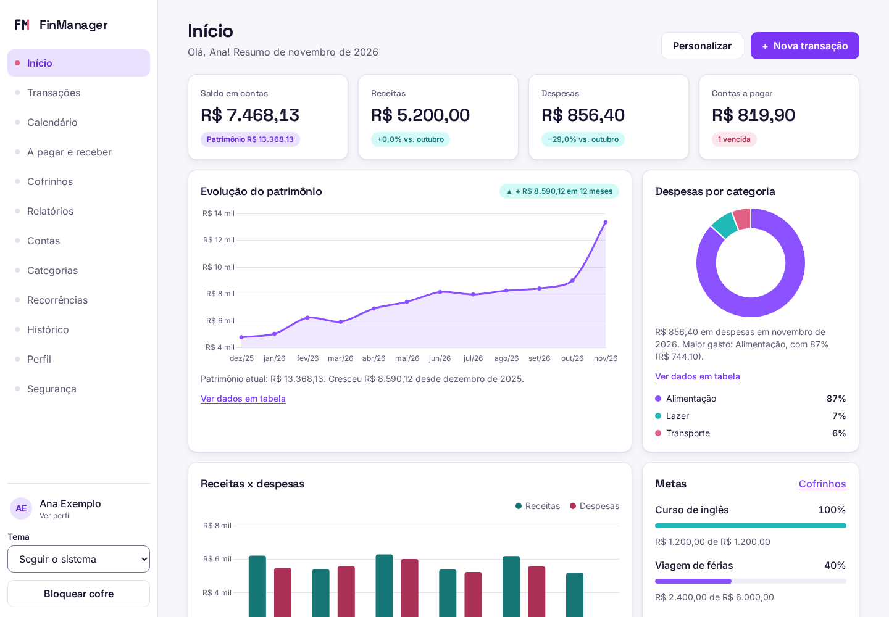
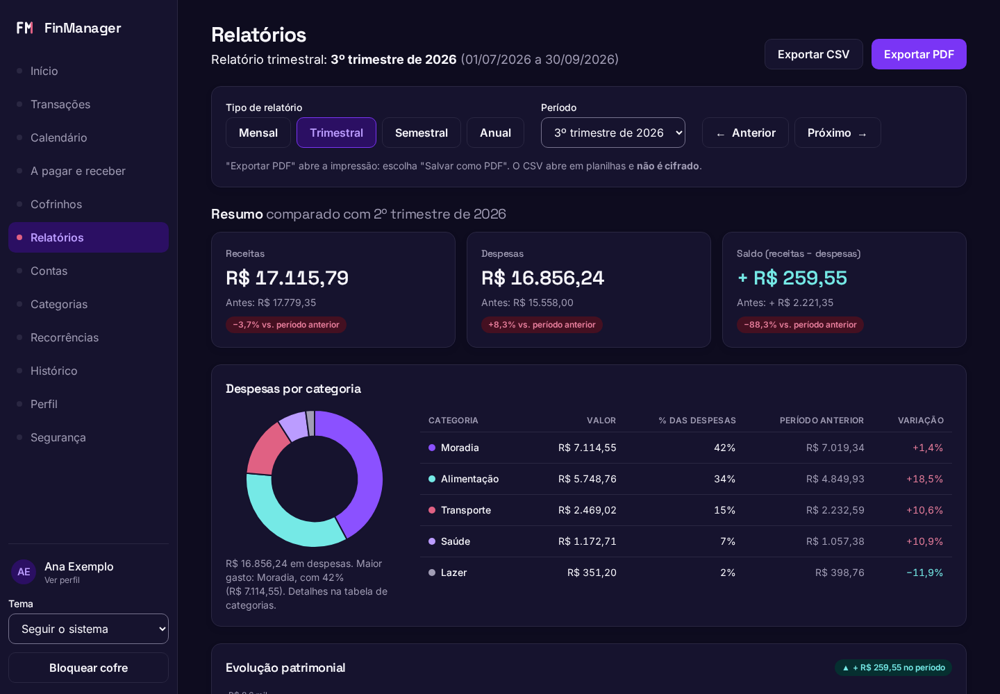

# FinManager

[](https://github.com/roberto-takada/FinManager/actions/workflows/deploy-pages.yml)
[](https://github.com/roberto-takada/FinManager/actions/workflows/e2e.yml)
[](./LICENSE)

Gerenciador de finanças pessoais **local-first**, **sem servidor** e com **criptografia ponta a ponta**. Todos os dados ficam cifrados no seu navegador; nada é enviado pela rede.

**[▶ Abrir o FinManager](https://roberto-takada.github.io/FinManager/)** · versão **beta**



> Para explorar sem digitar nada, marque **"Preencher com dados de demonstração"** ao criar o cofre: o app cria um usuário fictício com 12 meses de uso.

## Como seus dados são protegidos

- **Cofre cifrado:** uma chave aleatória (AES-256-GCM) cifra todos os dados. Ela fica protegida pela sua **senha mestra** (derivada com Argon2id) e por uma **chave de recuperação**, gerada na criação do cofre.
- **Nada sai do navegador:** sem backend, sem contas online, sem telemetria, sem CDNs e sem IA externa. A Content Security Policy bloqueia qualquer conexão a outros endereços. O service worker que permite o uso offline guarda só os arquivos do app, nunca os seus dados.
- **Só texto cifrado no disco:** o IndexedDB guarda apenas blocos cifrados. Ao bloquear o cofre (manualmente, por inatividade ou fechando a aba), a chave e os dados decifrados são descartados da memória.
- **Backup cifrado:** a exportação gera um `.json` que só abre com a senha mestra vigente na exportação ou com a chave de recuperação.

> ⚠️ **Não existe "esqueci minha senha".** Se você perder a senha mestra **e** a chave de recuperação, os dados não podem ser recuperados por ninguém. E, como tudo vive no navegador, limpar os dados de navegação apaga o cofre: exporte backups com frequência.

## Funcionalidades

| Área | O que já funciona |
|---|---|
| **Cofre** | Criar, desbloquear, bloqueio automático por inatividade, trocar a senha, chave de recuperação, apagar tudo |
| **Transações** | Receitas, despesas e transferências; contas e categorias (com subcategorias); recorrências; filtros e busca |
| **Agenda** | Contas a pagar e a receber, calendário mensal e semanal, alertas e notificações do navegador, exportação iCal |
| **Cofrinhos** | Objetivos com meta e prazo, depósitos e retiradas, progresso e quanto guardar por mês |
| **Início (dashboard)** | Resumo do mês, evolução do patrimônio, despesas por categoria, receitas x despesas, metas e contas a vencer; widgets personalizáveis |
| **Relatórios** | Mensal, trimestral, semestral e anual, comparados com o período anterior; exportação em CSV e PDF |
| **Perfil** | Nome, e-mail e avatar (iniciais ou foto); tema claro/escuro; tamanho do texto, alto contraste e redução de animações |
| **Segurança dos dados** | Confirmação de ações importantes; "Desfazer" logo após excluir; histórico e lixeira com restauração por 180 dias, exclusão definitiva e esvaziar lixeira; exportação do backup cifrado |
| **Nada se perde** | Formulários salvos automaticamente como rascunho cifrado e oferecidos de volta depois de fechar a aba ou o cofre bloquear; aviso ao sair sem salvar |
| **Sem internet** | Depois do primeiro acesso, funciona offline e pode ser instalado como aplicativo (PWA) |



## Acessibilidade

O objetivo é atender às **WCAG 2.2 nível AA**, e cada tela é verificada com [axe](https://github.com/dequelabs/axe-core) nos testes automatizados, nos temas claro e escuro.

- Tudo funciona só com o teclado, com foco sempre visível.
- Todo gráfico tem um resumo em texto e uma tabela com os mesmos dados.
- A informação nunca depende só de cor: valores levam sinal (+/−) e situações levam texto ou símbolo.
- O usuário pode aumentar o texto, ativar alto contraste e reduzir animações; o app também segue a preferência do sistema.

## Tecnologias

[Angular 22](https://angular.dev) (componentes standalone, signals, zoneless) · TypeScript · [Tailwind CSS 4](https://tailwindcss.com) · [Chart.js](https://www.chartjs.org) · Web Crypto API · [hash-wasm](https://github.com/Daninet/hash-wasm) (Argon2id) · [idb](https://github.com/jakearchibald/idb) · [date-fns](https://date-fns.org) · Vitest · Playwright · pnpm

## Rodar localmente

Requisitos: **Node.js 26** e **pnpm 12**.

```sh
pnpm install
pnpm start            # abre em http://localhost:4200
```

Outros comandos:

```sh
pnpm test --watch=false   # testes unitários (Vitest)
pnpm e2e                  # testes de ponta a ponta (Playwright, Chromium e Firefox)
pnpm lint                 # ESLint, incluindo as fronteiras entre camadas
pnpm typecheck            # verificação de tipos
pnpm build                # build de produção em dist/finmanager
pnpm build:pages          # build para o GitHub Pages (base /FinManager/)
```

Antes da primeira execução dos testes de ponta a ponta, instale os navegadores do Playwright: `pnpm exec playwright install chromium firefox`.

## Arquitetura

Arquitetura em camadas (hexagonal), com o domínio em TypeScript puro:

```
src/app/
  domain/          regras de negócio e cálculos (TypeScript puro)
  application/     casos de uso e portas
  infrastructure/  adaptadores: IndexedDB, Web Crypto, Argon2id
  features/        telas, carregadas sob demanda
  ui/              componentes acessíveis do design system
  core/            inicialização, rotas e ligação das portas aos adaptadores
```

Valores monetários são sempre inteiros em centavos (nunca ponto flutuante). A publicação no GitHub Pages é feita pelo GitHub Actions a cada push na `main`, depois que formatação, lint, tipos e testes passam.

A documentação completa está em [`docs/`](./docs):

- [Engenharia de Requisitos](./docs/ENGENHARIA_DE_REQUISITOS.md): regras de negócio, requisitos e histórias de usuário.
- [Engenharia de Software](./docs/ENGENHARIA_DE_SOFTWARE.md): arquitetura, design das regras críticas, segurança e testes.
- Decisões de arquitetura (ADRs): [stack](./docs/adr/0001-escolha-da-stack.md), [criptografia ponta a ponta](./docs/adr/0002-criptografia-ponta-a-ponta.md), [local-first](./docs/adr/0003-local-first-sem-servidor.md), [IA local](./docs/adr/0004-ia-local.md), [GitHub Pages e licença](./docs/adr/0005-hospedagem-github-pages.md).

## Roteiro

**Próximos passos**

- Importar o backup e pontos de restauração automáticos (RF-091 a RF-099)
- Cartão de crédito com faturas e parcelamento (RF-100 a RF-107)
- Escolha e troca da moeda do app, com as preferências de formato (RF-083, RF-110 a RF-113)
- Projeções e assistentes locais, sem serviços externos (RF-060 a RF-065)

**Depois da versão 1.0**

- Importação de extratos CSV/OFX (RF-018)
- Relatórios em período personalizado (RF-054)
- Arrastar e soltar widgets e seletor de período no Início (RF-046, RF-047)

## Licença

[GPL-3.0-or-later](./LICENSE). Você pode usar, estudar, modificar e redistribuir o código, desde que as versões modificadas também sejam distribuídas sob a GPL.
