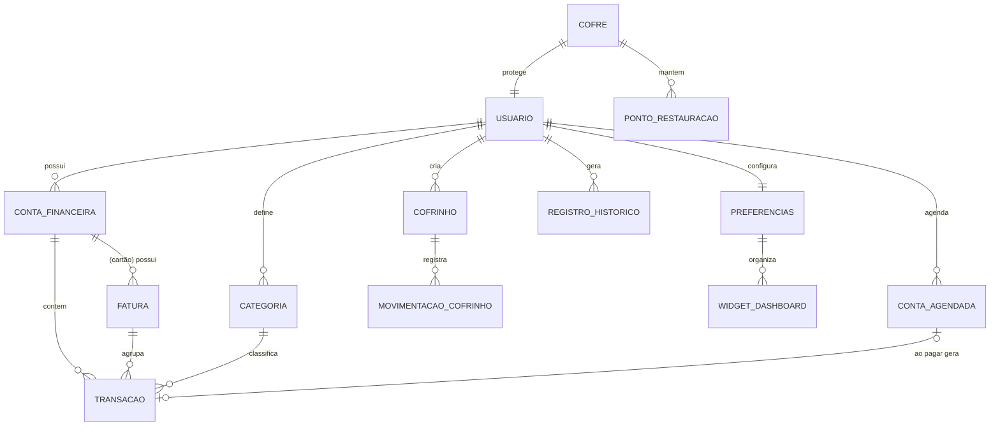

# FinManager — Documento de Engenharia de Requisitos

> **Versão:** 0.7
> **Data:** 2026-11-05
> **Autor:** Roberto Takada
> **Status:** Em elaboração — todas as [Questões em Aberto](#10-questões-em-aberto) (QA-001 a QA-012) resolvidas

---

## Sumário

1. [Introdução](#1-introdução)
2. [Visão Geral do Produto](#2-visão-geral-do-produto)
3. [Partes Interessadas e Personas](#3-partes-interessadas-e-personas)
4. [Regras de Negócio](#4-regras-de-negócio)
5. [Requisitos Funcionais](#5-requisitos-funcionais)
6. [Requisitos Não Funcionais](#6-requisitos-não-funcionais)
7. [Histórias de Usuário e Critérios de Aceitação](#7-histórias-de-usuário-e-critérios-de-aceitação)
8. [Modelo Conceitual de Domínio](#8-modelo-conceitual-de-domínio)
9. [Priorização (MoSCoW) e Releases](#9-priorização-moscow-e-releases)
10. [Questões em Aberto](#10-questões-em-aberto)
11. [Matriz de Rastreabilidade](#11-matriz-de-rastreabilidade)
12. [Glossário](#12-glossário)
13. [Histórico de Revisões](#13-histórico-de-revisões)

---

## 1. Introdução

### 1.1 Propósito
Este documento descreve **o que** o FinManager deve fazer — objetivos, regras de negócio, requisitos funcionais e não funcionais — servindo como fonte única de verdade para o desenvolvimento. **Como** o sistema será construído está descrito em [ENGENHARIA_DE_SOFTWARE.md](./ENGENHARIA_DE_SOFTWARE.md).

### 1.2 Escopo
O FinManager é um webapp de gerenciamento de finanças pessoais que permite registrar receitas e despesas, acompanhar a evolução do patrimônio, organizar objetivos de economia ("cofrinhos"), visualizar contas a pagar/receber em um calendário, gerar relatórios periódicos e receber auxílio de IA na gestão financeira.

O FinManager é **local-first** e usa **criptografia ponta a ponta**: todos os dados ficam armazenados exclusivamente no navegador do usuário, cifrados com uma chave derivada da sua senha mestra. Não existe servidor nem banco de dados remoto. O backup e a transferência entre dispositivos são feitos por meio de um arquivo `.json` exportado, também criptografado.

**Fora do escopo (nesta fase):**
- Servidor de aplicação, banco de dados remoto e contas de usuário online.
- Sincronização automática entre dispositivos ou navegadores (apenas via exportação/importação manual).
- Contas em múltiplas moedas e conversão de câmbio (previstas para versão posterior, via API — QA-012).
- Recuperação de dados pelo desenvolvedor: sem a senha mestra (ou chave de recuperação), os dados são irrecuperáveis.
- Integração direta com bancos (Open Finance) e importação automática de extratos.
- Gestão financeira empresarial, multiusuário compartilhado ou familiar.
- Operações financeiras reais (pagamentos, transferências, investimentos).
- Aplicativo mobile nativo (o webapp deve ser responsivo).
- Consultoria financeira profissional — a IA é apenas assistiva.

### 1.3 Convenções
- **RN-XXX**: Regra de Negócio
- **RF-XXX**: Requisito Funcional
- **RNF-XXX**: Requisito Não Funcional
- **US-XXX**: História de Usuário (*User Story*)
- **QA-XXX**: Questão em Aberto
- Palavras-chave **DEVE**, **NÃO DEVE**, **DEVERIA** e **PODE** seguem o sentido da RFC 2119 (obrigatório, proibido, recomendado e opcional).

---

## 2. Visão Geral do Produto

### 2.1 Declaração de Visão
> **Para** pessoas que querem organizar e planejar suas finanças pessoais,
> **o** FinManager **é** um webapp de gestão financeira
> **que** centraliza receitas, despesas, objetivos e projeções em um painel personalizável, seguro e acessível.
> **Diferente de** planilhas manuais e de apps financeiros na nuvem,
> **nosso produto** mantém os dados apenas no dispositivo do usuário, protegidos por criptografia ponta a ponta, nunca perde o trabalho do usuário e oferece relatórios e projeções automáticas.

### 2.2 Objetivos

| ID | Tipo | Objetivo |
|----|------|----------|
| OBJ-01 | Primário | Criar um webapp voltado para o gerenciamento de finanças pessoais. |
| OBJ-02 | Primário | Servir de instrumento de aprendizado de Engenharia de Software, Engenharia de Requisitos e Vibecoding. |
| OBJ-03 | Secundário | Construir um sistema robusto, seguro e de fácil uso, seguindo recomendações de acessibilidade e convenções de UI/UX. |
| OBJ-04 | Secundário | Oferecer dashboard de evolução patrimonial, cofrinhos para objetivos, projeção de gastos futuros e IAs simples de auxílio na gestão. |

### 2.3 Métricas de Sucesso
- O usuário consegue registrar uma transação em **menos de 30 segundos**.
- **Zero** perda de dados digitados em casos de fechamento acidental da aba ou queda de energia.
- Conformidade com **WCAG 2.2 nível AA** verificada por ferramenta automatizada e checklist manual.
- O próprio autor usa o FinManager como ferramenta principal de controle financeiro por **3 meses consecutivos**.

---

## 3. Partes Interessadas e Personas

### 3.1 Partes Interessadas

| Parte interessada | Interesse |
|---|---|
| Usuário final | Organizar finanças com segurança, praticidade e clareza. |
| Desenvolvedor (autor) | Aprender e aplicar boas práticas de engenharia; produto utilizável no dia a dia. |
| Assistente de IA (vibecoding) | Consumidor da documentação para gerar código alinhado aos requisitos. |
| Visitantes do portfólio (futuro) | Recrutadores e desenvolvedores que avaliam o repositório público: código, documentação e demonstração. |

### 3.2 Personas

**Persona 1 — "Organizado iniciante"**
Jovem adulto, renda fixa mensal, nunca controlou gastos de forma consistente. Quer saber "para onde vai o dinheiro" e começar a guardar para uma meta (ex.: viagem). Precisa de uma interface simples e de lembretes de contas.

**Persona 2 — "Planejador"**
Já usa planilhas, tem algumas fontes de renda e investimentos. Quer relatórios comparativos, projeções e visão de patrimônio ao longo do tempo. Valoriza personalização e exportação de dados.

---

## 4. Regras de Negócio

| ID | Regra | Detalhamento |
|----|-------|--------------|
| **RN-001** | **Criptografia ponta a ponta** | Todos os dados relevantes DEVEM ser criptografados no próprio dispositivo, com chave derivada da senha mestra do usuário, antes de serem gravados no navegador ou exportados. Os dados só existem em texto claro na memória, enquanto o cofre está desbloqueado. São considerados relevantes: valores, descrições, categorias, contas, cofrinhos, metas, dados de perfil, preferências e histórico. Isso inclui rascunhos (RN-002) e arquivos de backup (RN-012). |
| **RN-002** | **Persistência local de rascunhos** | O webapp DEVE salvar automaticamente no armazenamento do navegador toda adição/alteração em andamento, para que o trabalho do usuário seja preservado mesmo em caso de queda de energia, travamento ou fechamento acidental. Ao reabrir, o sistema DEVE oferecer a recuperação do trabalho não concluído. |
| **RN-003** | **Confirmação de alterações significativas** | Toda alteração significativa DEVE exigir confirmação explícita do usuário antes de ser efetivada. Ver lista de ações significativas em RN-005. |
| **RN-004** | **Histórico de exclusões e alterações** | O sistema DEVE manter um histórico (trilha de auditoria) das exclusões e alterações significativas, registrando o quê, quando e o estado anterior. Itens excluídos DEVEM ser restauráveis a partir desse histórico por **180 dias**; após esse prazo, são apagados definitivamente (QA-003). |
| **RN-005** | **Definição de "alteração significativa"** | São significativas, no mínimo: (a) exclusão de qualquer registro (transação, conta a pagar/receber, cofrinho, categoria, conta financeira); (b) edição de valor ou data de transação já registrada; (c) alteração em lote; (d) encerramento ou zeramento de cofrinho; (e) apagamento do cofre (todos os dados); (f) alteração da senha mestra ou da chave de recuperação; (g) importação de backup que substitua ou altere dados existentes; (h) troca da moeda do app. |
| **RN-006** | **Precisão monetária** | Valores monetários DEVEM ser armazenados e calculados sem perda de precisão (ex.: em centavos inteiros), nunca em ponto flutuante. |
| **RN-007** | **Moeda do app** | O app trabalha com **uma única moeda por vez**, escolhida pelo usuário (padrão: Real — BRL, formatado como R$ 1.234,56). O usuário PODE trocar essa moeda, mas **não há conversão de câmbio**: os valores são mantidos e passam a ser exibidos na nova moeda. Cada valor DEVE carregar o código da moeda (ISO 4217), preparando o modelo para múltiplas moedas e câmbio via API em versão futura (QA-005, QA-012). |
| **RN-008** | **Acesso somente com a senha mestra** | Somente quem conhece a senha mestra (ou possui a chave de recuperação) pode ler os dados. A senha mestra NUNCA DEVE ser armazenada, em nenhuma forma, em texto claro ou reversível. |
| **RN-009** | **IA assistiva, não decisória** | Sugestões geradas por IA DEVEM ser identificadas como tal e NUNCA DEVEM alterar dados sem confirmação explícita do usuário. |
| **RN-010** | **Privacidade e titularidade dos dados** | O usuário é o único titular e detentor dos seus dados. O app NÃO DEVE coletar telemetria, analytics ou qualquer dado de uso. O usuário DEVE poder exportar todos os seus dados e apagá-los definitivamente do navegador a qualquer momento. |
| **RN-011** | **Local-first, sem servidor** | Os dados DEVEM ser armazenados exclusivamente no navegador do usuário. Nenhum dado financeiro ou pessoal DEVE ser enviado pela rede, sem exceções — inclusive os recursos de IA, que rodam localmente (QA-004). |
| **RN-012** | **Backup por arquivo criptografado** | O usuário DEVE poder exportar todos os seus dados em um arquivo `.json` criptografado e importá-lo no mesmo ou em outro dispositivo/navegador. O arquivo é protegido pela **mesma senha mestra** vigente no momento da exportação e também pode ser aberto com a chave de recuperação (QA-010). Esse é o único mecanismo de backup e de transferência entre dispositivos. |
| **RN-013** | **Irrecuperabilidade sem credenciais** | Todo cofre DEVE ter uma chave de recuperação (QA-011). Como não há servidor, perder a senha mestra **e** a chave de recuperação significa perder os dados definitivamente. O usuário DEVE ser avisado disso de forma clara ao criar o cofre e DEVE confirmar que entendeu. |
| **RN-014** | **Risco de limpeza do navegador** | Como os dados vivem no navegador, limpar os dados de navegação ou desinstalar o navegador pode apagá-los. O app DEVE informar esse risco e incentivar backups periódicos. |
| **RN-015** | **Ponto de restauração antes de operações em massa** | Antes de uma importação substituir os dados atuais, ou de uma troca da moeda do app, o sistema DEVE criar automaticamente um backup do estado atual (ponto de restauração), registrando **data/hora e motivo** (QA-009). |

---

## 5. Requisitos Funcionais

### 5.1 Cofre e Acesso (ACE)

> Não existe cadastro nem login em servidor. O "acesso" consiste em **criar** e **desbloquear** um cofre local criptografado.

| ID | Requisito | Prioridade |
|----|-----------|-----------|
| RF-001 | No primeiro acesso, o sistema DEVE permitir criar o cofre definindo uma senha mestra, exibindo um medidor de força, exigindo força mínima e o aviso de irrecuperabilidade (RN-013). | Must |
| RF-002 | O sistema DEVE permitir desbloquear o cofre com a senha mestra e bloqueá-lo manualmente a qualquer momento. | Must |
| RF-003 | Ao criar o cofre, o sistema DEVE gerar uma **chave de recuperação** para o usuário guardar fora do app (anotar ou imprimir), que permite redefinir a senha mestra. O usuário DEVE confirmar que a guardou (ex.: redigitando parte dela). | Must |
| RF-004 | O sistema DEVE permitir alterar a senha mestra, exigindo a senha atual (RN-005). | Must |
| RF-005 | O sistema DEVE bloquear o cofre automaticamente após um período de inatividade configurável, removendo a chave e os dados decifrados da memória. | Must |
| RF-006 | O sistema DEVE permitir apagar definitivamente o cofre (todos os dados do navegador), com confirmação reforçada e sugestão de exportar um backup antes (RN-003, RN-010). | Must |
| RF-007 | O sistema DEVE permitir gerar uma nova chave de recuperação (invalidando a anterior), exigindo a senha mestra (RN-005). | Must |

### 5.2 Transações (TRN)

| ID | Requisito | Prioridade |
|----|-----------|-----------|
| RF-010 | O sistema DEVE permitir cadastrar receitas e despesas com: valor, data, descrição, categoria e conta financeira. O valor é registrado na moeda do app. | Must |
| RF-011 | O sistema DEVE permitir editar e excluir transações, respeitando RN-003 e RN-004. | Must |
| RF-012 | O sistema DEVE permitir cadastrar transações recorrentes (mensal, semanal, anual etc.). | Must |
| RF-013 | O sistema DEVE permitir transações parceladas (ex.: 10x no cartão), distribuindo cada parcela na fatura correspondente (ver seção 5.11). **Suspenso até a implementação do RF-100** (decisão de 2026-11-08): sem as faturas, as parcelas não cairiam no mês certo. | Should (após RF-100) |
| RF-014 | O sistema DEVE permitir filtrar e buscar transações por período, categoria, conta, tipo e texto. | Must |
| RF-015 | O sistema DEVE permitir gerenciar categorias e subcategorias personalizadas. | Must |
| RF-016 | O sistema DEVE permitir cadastrar contas financeiras (conta corrente, carteira, cartão de crédito, investimento). | Must |
| RF-017 | O sistema DEVERIA permitir transferências entre contas financeiras do próprio usuário, sem impactar receitas/despesas. | Should |
| RF-018 | O sistema PODE permitir importação de transações via arquivo (CSV/OFX). **Adiado para depois da release 1.0.** | Could (pós-1.0) |

### 5.3 Contas a Pagar / a Receber e Calendário (CAL)

| ID | Requisito | Prioridade |
|----|-----------|-----------|
| RF-020 | O sistema DEVE permitir cadastrar contas a pagar e a receber com valor, vencimento, descrição, categoria e recorrência. | Must |
| RF-021 | O sistema DEVE exibir um calendário com visões mensal e semanal das contas a pagar/receber. | Must |
| RF-022 | O sistema DEVE diferenciar visualmente contas pendentes, pagas/recebidas e vencidas (não apenas por cor — RNF de acessibilidade). | Must |
| RF-023 | O sistema DEVE permitir marcar uma conta como paga/recebida, gerando a transação correspondente. | Must |
| RF-024 | O sistema DEVERIA enviar **notificações do navegador** sobre contas próximas do vencimento (antecedência configurável) enquanto o app estiver aberto e o cofre desbloqueado (QA-007). Por padrão, o texto da notificação NÃO DEVE exibir valores nem descrições (ex.: "2 contas vencem amanhã"), pois notificações podem aparecer na tela de bloqueio do sistema. | Should |
| RF-025 | O sistema PODE permitir exportar o calendário em formato iCal (.ics). | Could |
| RF-026 | A permissão de notificação DEVE ser solicitada somente após uma ação explícita do usuário. Se negada, os alertas DEVEM aparecer dentro do app (Home e ao desbloquear). | Should |

### 5.4 Cofrinhos / Objetivos (COF)

| ID | Requisito | Prioridade |
|----|-----------|-----------|
| RF-030 | O sistema DEVE permitir criar cofrinhos com nome, valor-meta, prazo opcional e ícone/cor. | Must |
| RF-031 | O sistema DEVE permitir depositar e retirar valores de um cofrinho, registrando cada movimentação. | Must |
| RF-032 | O sistema DEVE exibir o progresso de cada cofrinho (valor atual, % da meta, valor restante). | Must |
| RF-033 | O sistema DEVERIA calcular quanto o usuário precisa guardar por mês para atingir a meta no prazo. | Should |
| RF-034 | O sistema DEVE exigir confirmação para encerrar/zerar um cofrinho (RN-005). | Must |

### 5.5 Dashboard e Patrimônio (DSH)

| ID | Requisito | Prioridade |
|----|-----------|-----------|
| RF-040 | O sistema DEVE exibir uma dashboard "Home" com resumo do mês: saldo, receitas, despesas e próximas contas. | Must |
| RF-041 | O sistema DEVE exibir gráfico de evolução do patrimônio ao longo do tempo (crescimento/diminuição). | Must |
| RF-042 | O sistema DEVE exibir gráfico de distribuição de despesas por categoria. | Must |
| RF-043 | O usuário DEVE poder personalizar a dashboard: adicionar, remover, reordenar e redimensionar widgets. | Should |
| RF-044 | A configuração da dashboard DEVE ser persistida por usuário. | Should |
| RF-045 | Todo gráfico DEVE possuir alternativa textual/tabular acessível. | Must |

### 5.6 Relatórios (REL)

| ID | Requisito | Prioridade |
|----|-----------|-----------|
| RF-050 | O sistema DEVE gerar, sob demanda, relatórios **mensais, trimestrais, semestrais e anuais**. | Must |
| RF-051 | O relatório DEVE conter: total de receitas, total de despesas, saldo, despesas por categoria, evolução patrimonial e situação dos cofrinhos no período. | Must |
| RF-052 | O relatório DEVERIA comparar o período selecionado com o período anterior equivalente. | Should |
| RF-053 | O sistema DEVERIA permitir exportar relatórios em PDF e CSV. | Should |
| RF-054 | O sistema PODE permitir relatórios em período personalizado (data inicial/final). | Could |

### 5.7 Projeções e IA (IA)

| ID | Requisito | Prioridade |
|----|-----------|-----------|
| RF-060 | O sistema DEVE projetar gastos e saldo futuros com base em recorrências e contas a pagar/receber cadastradas. | Should |
| RF-061 | O sistema DEVERIA sugerir automaticamente a categoria de uma transação a partir da descrição. | Should |
| RF-062 | O sistema DEVERIA detectar gastos fora do padrão (anomalias) e alertar o usuário. | Could |
| RF-063 | O sistema PODE gerar resumos e dicas em linguagem natural sobre a saúde financeira do usuário, a partir de modelos de texto (*templates*) preenchidos com cálculos locais. | Could |
| RF-065 | Todos os recursos de IA DEVEM ser executados localmente no navegador, sem chamadas de rede (RN-011, QA-004). | Must |
| RF-064 | Toda saída de IA DEVE ser identificada visualmente e exigir aceite do usuário para gerar efeitos (RN-009). | Must |

### 5.8 Rascunhos, Confirmações e Histórico (SEG)

| ID | Requisito | Prioridade |
|----|-----------|-----------|
| RF-070 | O sistema DEVE salvar automaticamente formulários em edição no armazenamento local do navegador, de forma criptografada (RN-001, RN-002). | Must |
| RF-071 | Ao reabrir o app, o sistema DEVE detectar rascunhos pendentes e oferecer "Restaurar" ou "Descartar". | Must |
| RF-072 | O sistema DEVE avisar o usuário ao tentar sair/fechar a página com alterações não salvas. | Must |
| RF-073 | O sistema DEVE funcionar integralmente sem conexão com a internet após o primeiro carregamento (aplicativo instalável/offline — PWA). | Should |
| RF-074 | O sistema DEVE exibir diálogo de confirmação para toda ação significativa (RN-005), descrevendo claramente a consequência. | Must |
| RF-075 | O sistema DEVE registrar no histórico: tipo de ação, entidade afetada, data/hora e estado anterior. | Must |
| RF-076 | O sistema DEVE disponibilizar uma tela de "Histórico/Lixeira" para consultar e restaurar itens excluídos, exibindo quantos dias faltam para a exclusão definitiva de cada item. | Must |
| RF-078 | O sistema DEVE apagar definitivamente itens da lixeira e registros de histórico com mais de **180 dias** (RN-004). Como não há servidor, essa limpeza ocorre ao desbloquear o cofre. | Must |
| RF-079 | O usuário DEVE poder esvaziar a lixeira manualmente ou excluir um item definitivamente antes do prazo, com confirmação (RN-005). | Should |
| RF-077 | O sistema DEVERIA oferecer "Desfazer" imediato (ex.: aviso temporário) após exclusões. | Should |

### 5.9 Perfil e Personalização (PRF)

| ID | Requisito | Prioridade |
|----|-----------|-----------|
| RF-080 | O usuário DEVE poder editar dados do perfil (nome, foto/avatar, e-mail). | Must |
| RF-081 | O usuário DEVE poder escolher tema (claro, escuro, seguir o sistema). | Should |
| RF-082 | O usuário DEVERIA poder ajustar tamanho de fonte, contraste e redução de animações. | Should |
| RF-083 | O usuário DEVERIA poder configurar preferências: moeda do app, primeiro dia da semana, dia de início do mês financeiro, formato de data, notificações. | Should |
| RF-084 | O usuário DEVE poder exportar todos os seus dados (ver seção 5.10) (RN-010). | Must |

### 5.10 Backup, Exportação e Importação (BKP)

| ID | Requisito | Prioridade |
|----|-----------|-----------|
| RF-090 | O sistema DEVE exportar todos os dados em um único arquivo `.json` criptografado com a senha mestra atual, contendo os metadados necessários (versão do formato, parâmetros de derivação de chave) para ser importado em outro navegador (RN-012). | Must |
| RF-091 | O sistema DEVE importar um arquivo de backup mediante a senha mestra que estava vigente quando ele foi exportado (ou a chave de recuperação correspondente), verificando integridade e versão antes de aplicar qualquer alteração. | Must |
| RF-092 | Antes de importar, o sistema DEVE exibir um resumo do conteúdo do arquivo (data do backup, quantidade de registros) e pedir confirmação, deixando claro que **os dados atuais serão substituídos** (RN-005, QA-009). | Must |
| RF-093 | O sistema DEVE rejeitar arquivos corrompidos, adulterados ou de versão incompatível com uma mensagem clara, sem alterar os dados atuais. | Must |
| RF-094 | O sistema DEVE migrar automaticamente backups de versões anteriores do formato para a versão atual. | Should |
| RF-095 | O sistema DEVERIA lembrar o usuário de fazer backup periodicamente (intervalo configurável) e exibir a data do último backup. Ao alterar a senha mestra, DEVE avisar que backups antigos continuam abrindo apenas com a senha antiga (ou com a chave de recuperação) e sugerir um novo backup. | Should |
| RF-096 | O sistema DEVE solicitar ao navegador armazenamento persistente, para reduzir o risco de os dados serem apagados automaticamente (RN-014). | Must |
| RF-097 | O sistema PODE permitir exportar os dados em formato legível (CSV/JSON não criptografado), somente com confirmação reforçada e aviso de que o arquivo ficará desprotegido. | Could |
| RF-098 | Antes de toda importação ou troca de moeda, o sistema DEVE criar automaticamente um **ponto de restauração** cifrado com o estado atual, registrando data/hora e motivo (ex.: "Antes de importar backup de 01/10/2026", "Antes de trocar a moeda de BRL para USD") (RN-015). | Must |
| RF-099 | O sistema DEVE listar os pontos de restauração (data, motivo, tamanho), permitindo restaurá-los (com confirmação), baixá-los como arquivo e excluí-los. São mantidos os **5 mais recentes** por padrão (configurável). | Must |

### 5.11 Cartão de Crédito e Faturas (CRT)

> Decisão QA-008: despesas de cartão entram nos relatórios e no saldo **pela fatura** (regime de competência da fatura), mas a **data da compra** é sempre armazenada.

| ID | Requisito | Prioridade |
|----|-----------|-----------|
| RF-100 | O cartão de crédito DEVE ter: limite, **dia de fechamento** e **dia de vencimento** da fatura. | Must |
| RF-101 | Toda compra no cartão DEVE armazenar a **data da compra** e ser atribuída automaticamente à fatura correspondente, conforme o dia de fechamento. O usuário PODE mover manualmente uma compra para outra fatura. | Must |
| RF-102 | Compras parceladas DEVEM gerar uma parcela em cada fatura subsequente, mantendo a data da compra original e a indicação "parcela X de N". | Must |
| RF-103 | Relatórios, dashboard e projeções DEVEM considerar as despesas de cartão no mês da **fatura** (vencimento). Listas e filtros DEVEM permitir visualizar também pela data da compra. | Must |
| RF-104 | Cada fatura DEVE ter status (aberta, fechada, paga, parcialmente paga) e aparecer no calendário como conta a pagar na data de vencimento. | Must |
| RF-105 | O pagamento da fatura DEVE ser registrado como **transferência** da conta de origem para o cartão, sem contar a despesa duas vezes. | Must |
| RF-106 | O sistema DEVERIA exibir o limite utilizado e o disponível, considerando as parcelas futuras. | Should |
| RF-107 | O sistema DEVERIA permitir registrar estornos e créditos na fatura. | Should |

### 5.12 Moeda do App (MOE)

> Decisões QA-005 e QA-012: nesta versão, uma única moeda por vez, escolhida pelo usuário. Câmbio via API e contas em múltiplas moedas ficam para uma versão posterior.

| ID | Requisito | Prioridade |
|----|-----------|-----------|
| RF-110 | O usuário DEVE escolher a moeda do app ao criar o cofre (padrão BRL), a partir de uma lista de moedas ISO 4217 (RN-007). | Must |
| RF-111 | O usuário DEVE poder trocar a moeda do app. Antes da troca, o sistema DEVE avisar claramente que **os valores não serão convertidos** (R$ 100,00 passa a ser US$ 100.00), pedir confirmação e criar um ponto de restauração (RN-005, RN-015). | Must |
| RF-112 | Se a nova moeda tiver menos casas decimais que a atual (ex.: BRL → JPY), o sistema DEVE informar quantos valores serão arredondados antes da confirmação. | Should |
| RF-113 | Valores DEVEM ser formatados conforme a moeda do app (símbolo e casas decimais) e a localidade do usuário. | Must |
| RF-114 | *(Versão futura)* Contas financeiras em moedas diferentes, com conversão para a moeda do app por taxas obtidas via API. Exigirá um ADR revendo RN-011, pois implica chamadas de rede. | Won't (nesta versão) |

---

## 6. Requisitos Não Funcionais

### 6.1 Segurança

| ID | Requisito |
|----|-----------|
| RNF-001 | O app DEVE ser servido exclusivamente via HTTPS (requisito também da Web Crypto API e dos Service Workers). |
| RNF-002 | Os dados DEVEM ser cifrados com algoritmo autenticado (AES-256-GCM via Web Crypto API), com vetor de inicialização (IV) único por operação de cifragem. |
| RNF-003 | A chave DEVE ser derivada da senha mestra com função de derivação lenta e com *salt* aleatório: Argon2id (preferencial) ou PBKDF2-SHA-256 com no mínimo 600.000 iterações (recomendação OWASP). |
| RNF-004 | A chave de criptografia e os dados decifrados DEVEM existir apenas em memória e ser descartados ao bloquear o cofre ou fechar a aba; a chave NUNCA DEVE ser persistida em texto claro. |
| RNF-005 | O sistema DEVE mitigar as vulnerabilidades do **OWASP Top 10** aplicáveis a aplicações client-side, com ênfase em **XSS** (Content Security Policy restritiva, sem `eval`, sem HTML não sanitizado) e em **dependências vulneráveis**. |
| RNF-006 | Tentativas de desbloqueio com senha errada DEVEM ter atraso progressivo na interface; a proteção real contra força bruta vem do custo da função de derivação de chave (RNF-003). |
| RNF-007 | Nenhum segredo, chave, backup ou dado financeiro real DEVE ser versionado no repositório (que será público). |
| RNF-008 | O app NÃO DEVE registrar dados financeiros ou pessoais no console, nem enviar telemetria, analytics ou relatórios de erro para serviços externos. |
| RNF-009 | Os recursos de IA DEVEM usar apenas técnicas executáveis no navegador (regras, estatística, modelos leves embarcados), sem dependência de serviços externos. |

### 6.2 Confiabilidade e Disponibilidade

| ID | Requisito |
|----|-----------|
| RNF-010 | Nenhuma entrada do usuário DEVE ser perdida por fechamento acidental, queda de energia ou perda de conexão (RN-002). |
| RNF-011 | O rascunho local DEVE ser salvo em no máximo **2 segundos** após a última alteração. |
| RNF-012 | O ciclo exportar → importar DEVE ser coberto por testes automatizados que garantam restauração fiel de 100% dos dados. |
| RNF-013 | Operações de escrita DEVEM ser atômicas: uma transação nunca fica "pela metade", mesmo se a aba for fechada durante a gravação. |
| RNF-014 | O app DEVE tratar com segurança o uso em várias abas simultâneas (sem sobrescrever dados de outra aba nem corromper o armazenamento). |

### 6.3 Usabilidade e Acessibilidade

| ID | Requisito |
|----|-----------|
| RNF-020 | A interface DEVE atender às **WCAG 2.2 nível AA**. |
| RNF-021 | Todas as funcionalidades DEVEM ser operáveis apenas por teclado, com foco visível. |
| RNF-022 | A interface DEVE ser compatível com leitores de tela (HTML semântico, rótulos, ARIA quando necessário). |
| RNF-023 | Contraste mínimo de 4,5:1 para texto normal e 3:1 para texto grande e componentes de interface. |
| RNF-024 | Informação NÃO DEVE ser transmitida apenas por cor (ex.: receita/despesa também com ícone ou sinal +/−). |
| RNF-025 | A interface DEVE ser responsiva (mínimo 320 px de largura) e funcionar com zoom de 200%. |
| RNF-026 | Mensagens de erro DEVEM ser claras, em português, e indicar como corrigir o problema. |
| RNF-027 | A interface DEVE seguir as heurísticas de usabilidade de Nielsen e manter consistência visual via design system. |
| RNF-028 | O sistema DEVE respeitar a preferência do sistema operacional por redução de movimento. |

### 6.4 Desempenho

| ID | Requisito |
|----|-----------|
| RNF-030 | A primeira página DEVERIA carregar em até 2,5 s (LCP) em conexão 4G. |
| RNF-031 | Interações comuns DEVERIAM responder em até 200 ms (INP). |
| RNF-032 | Relatórios anuais com até 10.000 transações DEVEM ser gerados em até 3 s. |
| RNF-033 | O desbloqueio do cofre (derivação de chave + decifragem) DEVERIA levar entre 0,5 s e 3 s em um computador comum: lento o bastante para dificultar força bruta, rápido o bastante para não incomodar. |

### 6.5 Manutenibilidade e Qualidade

| ID | Requisito |
|----|-----------|
| RNF-040 | O código DEVE seguir padrão de estilo automatizado (linter + formatador). |
| RNF-041 | As regras de negócio DEVEM ter cobertura de testes automatizados (meta: ≥ 80% no domínio). |
| RNF-042 | Decisões arquiteturais relevantes DEVEM ser registradas como ADRs. |
| RNF-043 | O projeto DEVE possuir pipeline de integração contínua executando lint e testes a cada *push*. |

### 6.6 Compatibilidade e Legal

| ID | Requisito |
|----|-----------|
| RNF-050 | O sistema DEVE funcionar nas duas últimas versões de Chrome, Firefox, Edge e Safari. |
| RNF-051 | Como nenhum dado é coletado pelo desenvolvedor, o tratamento de dados se limita ao dispositivo do usuário. Ainda assim, o sistema DEVE seguir os princípios da LGPD (transparência, portabilidade e eliminação). |
| RNF-052 | O sistema DEVE apresentar um aviso de privacidade simples, explicando que os dados nunca saem do dispositivo e que o usuário é responsável por seus backups e por sua senha. |

### 6.7 Portfólio Público

| ID | Requisito |
|----|-----------|
| RNF-060 | O repositório DEVE ser distribuído sob a licença **GPL-3.0** e ter um README que explique o projeto, as decisões de arquitetura e como executá-lo. |
| RNF-061 | O app DEVE oferecer um **modo demonstração** com dados fictícios, para que visitantes explorem as funcionalidades sem cadastrar dados reais. |
| RNF-062 | O app DEVE ser publicado no **GitHub Pages** (hospedagem estática, sem backend), permitindo uma demonstração online. |
| RNF-064 | O app NÃO DEVE funcionar dentro de `iframe` (proteção contra *clickjacking*), já que o GitHub Pages não permite configurar `frame-ancestors`. |
| RNF-063 | O `.gitignore` DEVE impedir o versionamento de arquivos de backup (`.json` exportados) e de arquivos locais de ambiente. |

---

## 7. Histórias de Usuário e Critérios de Aceitação

> Formato: *Como [persona], quero [ação] para [benefício].*
> Critérios em formato **Dado / Quando / Então** (Gherkin).

### US-001 — Registrar despesa
**Como** usuário, **quero** registrar uma despesa rapidamente **para** manter meu controle em dia.
- **Dado** que o cofre está desbloqueado, **quando** preencho valor, data, categoria e conta e confirmo, **então** a despesa aparece na lista e o saldo é atualizado.
- **Dado** que informo valor zero, negativo ou vazio, **quando** tento salvar, **então** vejo uma mensagem de erro clara junto ao campo.
- **Rastreia:** RF-010, RN-006

### US-002 — Não perder o que estou digitando
**Como** usuário, **quero** que meu formulário seja salvo automaticamente **para** não perder dados se a página fechar.
- **Dado** que estou preenchendo uma transação, **quando** a aba é fechada e reaberta, **então** o sistema oferece restaurar o rascunho com os dados preenchidos.
- **Dado** que existe um rascunho, **quando** escolho "Descartar", **então** ele é removido do armazenamento local.
- **Dado** que inspeciono o armazenamento do navegador, **então** os dados do rascunho não estão legíveis em texto claro.
- **Rastreia:** RN-001, RN-002, RF-070, RF-071, RF-072

### US-003 — Excluir conta a pagar com segurança
**Como** usuário, **quero** confirmar antes de excluir uma conta a pagar e poder recuperá-la **para** evitar erros.
- **Dado** que clico em "Excluir", **então** vejo um diálogo descrevendo o item e a consequência, com as opções "Cancelar" (foco padrão) e "Excluir".
- **Dado** que confirmo, **então** o item sai do calendário e aparece em "Histórico/Lixeira" com data/hora da exclusão.
- **Dado** que estou na Lixeira, **quando** clico em "Restaurar", **então** o item volta ao calendário com os dados originais.
- **Rastreia:** RN-003, RN-004, RF-074, RF-075, RF-076

### US-004 — Ver contas no calendário
**Como** usuário, **quero** ver minhas contas a pagar/receber em um calendário **para** planejar meu mês.
- **Dado** que tenho contas cadastradas, **quando** abro o calendário, **então** vejo cada conta no dia do vencimento com status (pendente/paga/vencida) indicado por texto ou ícone, além de cor.
- **Dado** que marco uma conta como paga, **então** uma transação correspondente é criada.
- **Rastreia:** RF-020 a RF-023

### US-005 — Criar cofrinho
**Como** usuário, **quero** criar um cofrinho com meta e prazo **para** juntar dinheiro para um objetivo.
- **Dado** que crio um cofrinho de R$ 6.000,00 com prazo de 12 meses, **então** o sistema exibe progresso 0% e sugere guardar R$ 500,00/mês.
- **Dado** que deposito R$ 600,00, **então** o progresso passa a 10%.
- **Rastreia:** RF-030 a RF-033

### US-006 — Gerar relatório trimestral
**Como** planejador, **quero** gerar um relatório trimestral **para** analisar meus hábitos financeiros.
- **Dado** que seleciono "Trimestral" e o 3º trimestre de 2026, **então** vejo receitas, despesas, saldo, gastos por categoria e comparação com o 2º trimestre.
- **Dado** que clico em "Exportar PDF", **então** recebo um arquivo com o mesmo conteúdo.
- **Rastreia:** RF-050 a RF-053

### US-007 — Personalizar a Home
**Como** usuário, **quero** escolher quais widgets aparecem na Home **para** ver primeiro o que importa para mim.
- **Dado** que estou no modo de edição, **quando** removo ou reordeno widgets (inclusive via teclado) e salvo, **então** a nova configuração é mantida em acessos futuros e incluída no backup exportado.
- **Rastreia:** RF-043, RF-044, RNF-021

### US-008 — Sugestão de categoria por IA
**Como** usuário, **quero** que o sistema sugira a categoria ao digitar a descrição **para** agilizar o cadastro.
- **Dado** que digito "Uber para o trabalho", **então** o sistema sugere "Transporte" com indicação visual de sugestão.
- **Dado** que ignoro a sugestão, **então** nenhuma categoria é aplicada automaticamente.
- **Rastreia:** RF-061, RF-064, RN-009

### US-009 — Criar e desbloquear o cofre
**Como** usuário, **quero** proteger meus dados com uma senha mestra **para** que ninguém com acesso ao meu computador consiga lê-los.
- **Dado** que é meu primeiro acesso, **quando** defino uma senha mestra forte e confirmo que entendi que ela não pode ser recuperada pelo app, **então** o cofre é criado e recebo uma chave de recuperação para guardar.
- **Dado** que o cofre está bloqueado, **quando** digito a senha correta, **então** vejo meus dados; **quando** digito uma senha errada, **então** vejo uma mensagem de erro e nada é revelado.
- **Dado** que fiquei inativo além do tempo configurado, **então** o cofre é bloqueado automaticamente.
- **Rastreia:** RF-001 a RF-005, RN-008, RN-013

### US-010 — Fazer backup e restaurar em outro navegador
**Como** usuário, **quero** exportar meus dados em um arquivo e importá-los em outro navegador **para** não perder minhas informações e poder trocar de computador.
- **Dado** que o cofre está desbloqueado, **quando** clico em "Exportar backup", **então** recebo um arquivo `.json` cujo conteúdo não é legível em texto claro.
- **Dado** que estou em outro navegador, **quando** importo o arquivo e informo a senha correta, **então** vejo um resumo do backup, confirmo, e todos os dados são restaurados exatamente como estavam.
- **Dado** que o arquivo foi alterado ou está corrompido, **quando** tento importá-lo, **então** a importação é recusada e meus dados atuais permanecem intactos.
- **Dado** que já existem dados neste navegador, **quando** confirmo a importação, **então** um ponto de restauração com data e motivo é criado antes da substituição, e posso desfazer a importação a partir dele.
- **Rastreia:** RF-090 a RF-093, RF-098, RF-099, RN-012, RN-015

### US-011 — Compra parcelada no cartão
**Como** usuário, **quero** que minhas compras no cartão apareçam na fatura certa **para** saber quanto vou pagar em cada mês.
- **Dado** um cartão com fechamento no dia 5 e vencimento no dia 12, **quando** registro em 06/11/2026 uma compra de R$ 300,00 em 3x, **então** as parcelas de R$ 100,00 aparecem nas faturas com vencimento em 12/12/2026, 12/01/2027 e 12/02/2027, todas com data da compra 06/11/2026.
- **Dado** que gero o relatório de novembro/2026, **então** essa compra não aparece como despesa de novembro; aparece em dezembro/2026 (1/3).
- **Dado** que pago a fatura a partir da conta corrente, **então** o saldo da conta diminui, mas a despesa não é contada novamente.
- **Rastreia:** RF-100 a RF-105

---

## 8. Modelo Conceitual de Domínio

> Visão de alto nível das entidades e relacionamentos, independente de tecnologia.

| Entidade | Descrição | Atributos principais |
|---|---|---|
| Cofre | Metadados de criptografia (única parte não cifrada) | versão do formato, *salt*, parâmetros de derivação de chave, chave de dados cifrada pela senha e pela chave de recuperação, data do último backup |
| Usuário | Titular dos dados (único, local) | nome, avatar, data de criação |
| Conta financeira | Origem/destino do dinheiro | nome, tipo (corrente, carteira, cartão, investimento), saldo inicial; se cartão: limite, dia de fechamento, dia de vencimento |
| Fatura | Agrupamento das compras de um cartão por ciclo | cartão, período (abertura/fechamento), vencimento, total, valor pago, status |
| Categoria | Classificação de transações | nome, tipo (receita/despesa), ícone, cor, categoria-pai |
| Transação | Movimento efetivado | tipo, valor (unidades mínimas da moeda), moeda, data de competência, data da compra (cartão), fatura (cartão), descrição, categoria, conta, recorrência, parcela X/N |
| Conta agendada | Conta a pagar/receber | tipo, valor, vencimento, recorrência, status |
| Cofrinho | Objetivo de economia | nome, meta, prazo, saldo atual, status |
| Movimentação de cofrinho | Depósito/retirada | tipo, valor, data |
| Registro de histórico | Trilha de auditoria | ação, entidade, id, estado anterior, data/hora, data de expiração (+180 dias) |
| Ponto de restauração | Backup automático local | data/hora, motivo, conteúdo cifrado, tamanho |
| Preferências | Personalização | moeda do app, tema, acessibilidade, layout da dashboard, formatos, notificações |

---

## 9. Priorização (MoSCoW) e Releases

| Release | Foco | Conteúdo principal |
|---|---|---|
| **MVP (v0.1)** | Núcleo utilizável | Cofre criptografado (criar, desbloquear, bloqueio automático, chave de recuperação); exportação/importação de backup com pontos de restauração; armazenamento persistente; transações; categorias; contas financeiras; rascunhos locais; confirmações; histórico/lixeira; dashboard fixa básica; relatório mensal; escolha e troca da moeda do app (modelo de dados já com moeda em todo valor). |
| **v0.2** | Planejamento | Contas a pagar/receber; calendário; notificações do navegador; recorrências; cartão de crédito e faturas; parcelamentos; cofrinhos; relatórios trimestral/semestral/anual. |
| **v0.3** | Personalização e portfólio | Dashboard personalizável; temas e acessibilidade avançada; perfil; exportação de relatórios; modo demonstração; publicação em hospedagem estática. |
| **v0.4** | Inteligência | Projeções; sugestão de categoria; detecção de anomalias; resumos em linguagem natural. |
| **v0.5+** | Evolução | Câmbio via API e contas em múltiplas moedas (requer ADR revendo RN-011); PWA instalável/offline; lembretes de backup; iCal. |
| **Pós-1.0** | Depois da primeira versão completa | Importação de transações via arquivo CSV/OFX (RF-018). |

> **Por que o backup está no MVP:** sem servidor, a exportação é a única proteção contra perda de dados (RN-012, RN-014). Usar o app com dados reais sem backup seria um risco inaceitável.

---

## 10. Questões em Aberto

> Decisões que precisam ser tomadas antes ou durante a implementação. Cada resposta deve atualizar este documento.

### 10.1 Pendentes

Nenhuma no momento. Novas questões devem receber o próximo número (QA-013).

### 10.2 Resolvidas

| ID | Questão | Decisão | Data |
|----|---------|---------|------|
| QA-001 | Criptografia ponta a ponta ou do lado do servidor? | **Ponta a ponta.** A chave é derivada da senha mestra e nunca sai do dispositivo (RN-001, RN-008, RN-013). Registrada no ADR-0002. | 2026-11-05 |
| QA-002 | Local-first ou servidor como fonte da verdade? | **Local-first, sem servidor nem banco remoto.** Os dados ficam só no navegador; backup e migração entre dispositivos por arquivo `.json` criptografado (RN-011, RN-012). Registrada no ADR-0003. | 2026-11-05 |
| QA-003 | Prazo de retenção da lixeira/histórico? | **180 dias**, depois exclusão definitiva (RN-004, RF-078). | 2026-11-05 |
| QA-004 | IA local ou serviço externo? | **Somente local**, no navegador (RN-011, RF-065, RNF-009). Registrada no ADR-0004. | 2026-11-05 |
| QA-005 | Múltiplas moedas? | **Sim**, conforme escolha do usuário. Escopo refinado pela QA-012 (RN-007, seção 5.12). | 2026-11-05 |
| QA-006 | Uso pessoal ou aberto ao público? | **Uso pessoal agora; no futuro, projeto de portfólio público no GitHub.** Não há contas de terceiros nem coleta de dados; o repositório deve estar pronto para ser público (RNF-060 a RNF-063). | 2026-11-05 |
| QA-007 | Canal de notificações? | **Notificações do navegador enquanto o app estiver aberto** (RF-024, RF-026). | 2026-11-05 |
| QA-008 | Cartão de crédito por data da compra ou por fatura? | **Por fatura**, armazenando também a data da compra (seção 5.11). | 2026-11-05 |
| QA-009 | Importar: substituir ou mesclar? | **Substituir**, criando antes um backup automático com data e motivo (RN-015, RF-098, RF-099). | 2026-11-05 |
| QA-010 | Senha do arquivo de backup? | **A mesma senha mestra** (RN-012, RF-090, RF-091). | 2026-11-05 |
| QA-011 | Chave de recuperação no MVP? | **Sim** (RN-013, RF-003, RF-007). | 2026-11-05 |
| QA-012 | Taxas de câmbio manuais ou via API? | **Por enquanto, sem câmbio:** o usuário apenas escolhe/troca a moeda do app, sem conversão. Câmbio via API e múltiplas moedas em versão posterior (RN-007, RF-110 a RF-114). | 2026-11-05 |

---

## 11. Matriz de Rastreabilidade

| Origem | Requisitos relacionados |
|---|---|
| OBJ-01 | RF-001 a RF-114 |
| OBJ-02 (aprendizado/portfólio) | RNF-040 a RNF-043, RNF-060 a RNF-063 |
| OBJ-03 (robusto/seguro) | RN-001, RN-008, RN-010 a RN-014, RF-001 a RF-006, RNF-001 a RNF-014 |
| OBJ-03 (acessível/UX) | RF-045, RF-081, RF-082, RNF-020 a RNF-028 |
| OBJ-04 (dashboard/patrimônio) | RF-040 a RF-045 |
| OBJ-04 (cofrinhos) | RF-030 a RF-034 |
| OBJ-04 (projeções/IA) | RF-060 a RF-065, RN-009, RNF-009 |
| RN-001 | RF-001, RF-070, RF-090, RNF-002, RNF-003, RNF-004 |
| RN-002 | RF-070 a RF-073, RNF-010, RNF-011 |
| RN-003 / RN-005 | RF-004, RF-006, RF-011, RF-034, RF-074, RF-092 |
| RN-004 | RF-075 a RF-079 |
| RN-006 / RN-007 | RF-110 a RF-114 |
| RN-008 / RN-013 | RF-001 a RF-005, RNF-003, RNF-006 |
| RN-011 | RNF-008, RNF-009, RNF-062 |
| RN-012 / RN-014 / RN-015 | RF-090 a RF-099, RNF-012 |
| Cartão de crédito (QA-008) | RF-013, RF-100 a RF-107 |
| Feature: Relatórios | RF-050 a RF-054 |
| Feature: Customização | RF-043, RF-044, RF-080 a RF-083 |
| Feature: Calendário | RF-020 a RF-026, RF-104 |

---

## 12. Glossário

| Termo | Definição |
|---|---|
| **Cofre** | Conjunto de todos os dados do usuário, armazenado de forma criptografada no navegador. Pode estar *bloqueado* (ilegível) ou *desbloqueado* (dados decifrados apenas em memória). |
| **Senha mestra** | Senha escolhida pelo usuário da qual é derivada a chave que protege o cofre. Nunca é armazenada. |
| **Chave de recuperação** | Código aleatório gerado na criação do cofre, guardado pelo usuário fora do app, que permite redefinir a senha mestra. |
| **Criptografia ponta a ponta (E2E)** | Os dados são cifrados e decifrados apenas no dispositivo do usuário; nenhum terceiro tem acesso à chave. |
| **Local-first** | Arquitetura em que os dados vivem primariamente no dispositivo do usuário, e não em um servidor. |
| **Função de derivação de chave (KDF)** | Algoritmo propositalmente lento (ex.: Argon2id, PBKDF2) que transforma uma senha em uma chave criptográfica, dificultando ataques de força bruta. |
| **Salt** | Valor aleatório combinado à senha na derivação da chave, para que senhas iguais gerem chaves diferentes. |
| **PWA** | *Progressive Web App* — webapp que pode ser instalado e funcionar offline. |
| **Fatura** | Conjunto das compras de um cartão de crédito em um ciclo (entre dois fechamentos), pago em uma data de vencimento. |
| **Dia de fechamento** | Dia em que a fatura do cartão é encerrada; compras após essa data vão para a fatura seguinte. |
| **Ponto de restauração** | Backup automático e cifrado do estado atual, criado antes de operações que substituem dados (como importar um backup). |
| **Moeda do app** | Moeda única, escolhida pelo usuário, em que todos os valores são registrados e exibidos. |
| **ISO 4217** | Padrão internacional de códigos de moeda (BRL, USD, EUR...). |
| **Cofrinho** | Reserva de dinheiro vinculada a um objetivo, com meta de valor e prazo opcional. |
| **Conta financeira** | Local onde o dinheiro está (conta bancária, carteira, cartão, investimento). |
| **Conta agendada** | Conta a pagar ou a receber com data de vencimento futura. |
| **Transação** | Movimentação efetivada de dinheiro (receita, despesa ou transferência). |
| **Patrimônio** | Soma dos saldos de todas as contas financeiras e cofrinhos do usuário. |
| **Rascunho** | Dados de um formulário ainda não salvos definitivamente, guardados no navegador. |
| **Trilha de auditoria** | Registro cronológico das ações significativas realizadas pelo usuário. |
| **Exclusão lógica (soft delete)** | Marcar um registro como excluído sem apagá-lo fisicamente, permitindo restauração. |
| **WCAG** | *Web Content Accessibility Guidelines* — diretrizes internacionais de acessibilidade web. |
| **LGPD** | Lei Geral de Proteção de Dados Pessoais (Lei nº 13.709/2018). |
| **MoSCoW** | Técnica de priorização: *Must, Should, Could, Won't*. |

---

## 13. Histórico de Revisões

| Versão | Data | Autor | Descrição |
|---|---|---|---|
| 0.1 | 2026-11-05 | Roberto Takada | Versão inicial a partir dos objetivos, regras de negócio e features definidos. |
| 0.2 | 2026-11-05 | Roberto Takada | Resolvidas QA-001 (E2E), QA-002 (local-first, sem servidor) e QA-006 (uso pessoal → portfólio público). Seção 5.1 reescrita como "Cofre e Acesso"; nova seção 5.10 (Backup); novas RN-011 a RN-014; RNFs de segurança revisados; nova seção 6.7 (Portfólio); US-009 e US-010; novas QA-009 a QA-011. |
| 0.3 | 2026-11-05 | Roberto Takada | Resolvidas QA-003, QA-004, QA-005, QA-007, QA-008, QA-009, QA-010 e QA-011. Novas RN-015, RF-007, RF-026, RF-065, RF-078, RF-079, RF-098, RF-099; novas seções 5.11 (Cartão e Faturas) e 5.12 (Moedas); US-011; nova QA-012. |
| 0.4 | 2026-11-05 | Roberto Takada | Resolvida QA-012: uma única moeda por vez, trocável sem conversão; câmbio via API e múltiplas moedas adiados. Seção 5.12 reescrita; RN-005, RN-007, RN-015 e RF-098 ajustados. |
| 0.5 | 2026-11-05 | Roberto Takada | Licença GPL-3.0 e hospedagem no GitHub Pages (RNF-060, RNF-062); nova RNF-064 (anti-clickjacking). |
| 0.6 | 2026-11-08 | Roberto Takada | RF-018 (importação CSV/OFX) adiado para depois da release 1.0; nova linha "Pós-1.0" nas releases. |
| 0.7 | 2026-11-08 | Roberto Takada | RF-013 (parcelamento) suspenso até a implementação do RF-100 (faturas do cartão). |
