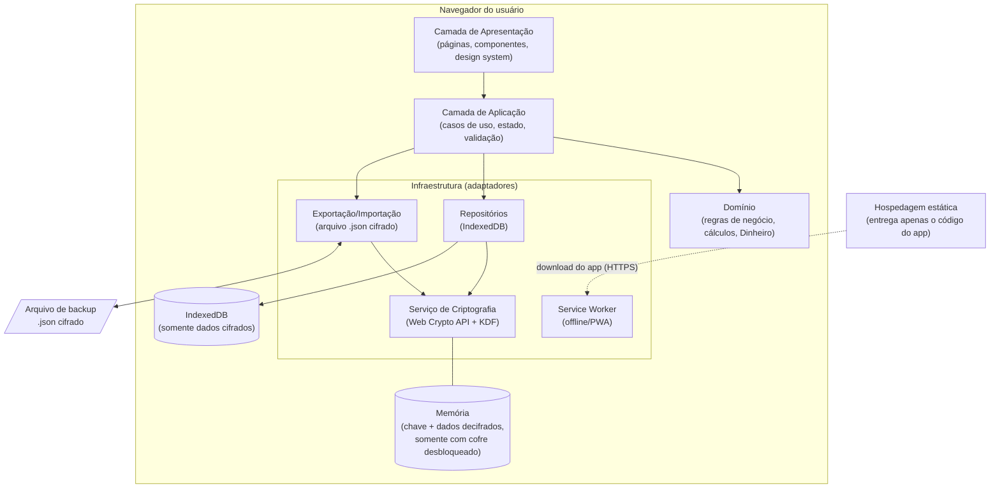
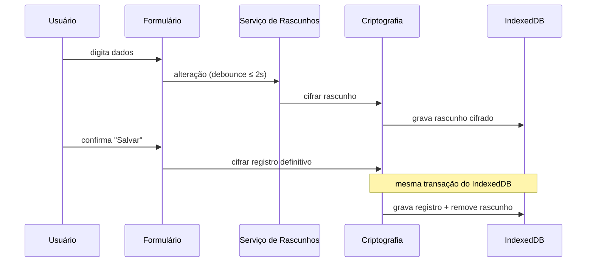
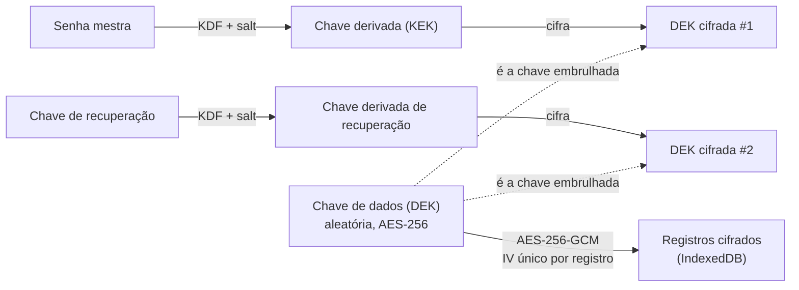
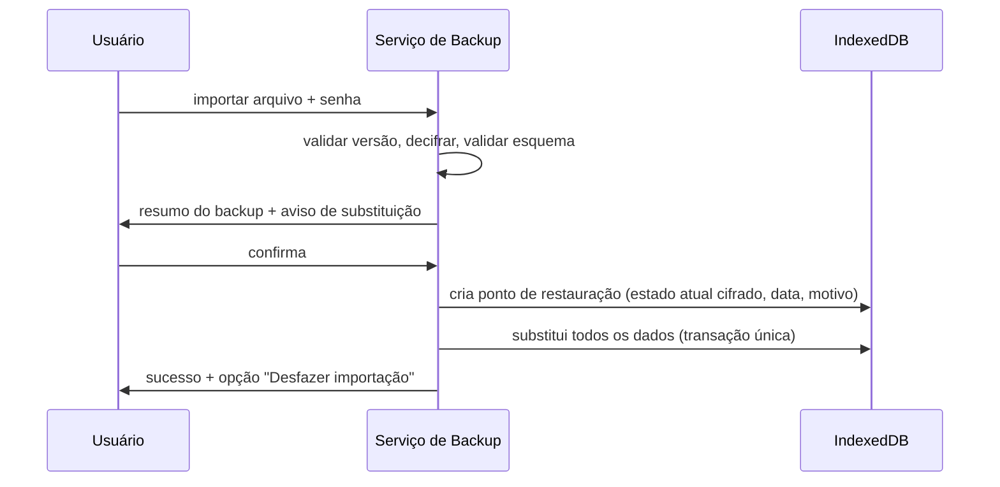

# FinManager — Documento de Engenharia de Software

> **Versão:** 0.8
> **Data:** 2026-11-05
> **Autor:** Roberto Takada
> **Status:** Em elaboração — arquitetura, stack, hospedagem e licença definidas (ADR-0001 a ADR-0005)
> **Documento relacionado:** [ENGENHARIA_DE_REQUISITOS.md](./ENGENHARIA_DE_REQUISITOS.md)

Este documento descreve **como** o FinManager será construído: processo de desenvolvimento, arquitetura, decisões de design, estratégia de qualidade e práticas de trabalho (incluindo vibecoding). A stack (**Angular + TypeScript + Tailwind CSS**) está registrada no [ADR-0001](./adr/0001-escolha-da-stack.md) e resumida na seção 13. Também estão decididos: **app 100% client-side, sem servidor nem banco remoto, com criptografia ponta a ponta** e backup por arquivo `.json` criptografado.

---

## Sumário

1. [Processo de Desenvolvimento](#1-processo-de-desenvolvimento)
2. [Fluxo de Trabalho com Vibecoding](#2-fluxo-de-trabalho-com-vibecoding)
3. [Princípios de Engenharia](#3-princípios-de-engenharia)
4. [Arquitetura](#4-arquitetura)
5. [Design das Regras de Negócio Críticas](#5-design-das-regras-de-negócio-críticas)
6. [Segurança](#6-segurança)
7. [UI/UX e Acessibilidade](#7-uiux-e-acessibilidade)
8. [Estratégia de Testes](#8-estratégia-de-testes)
9. [Controle de Versão e Integração Contínua](#9-controle-de-versão-e-integração-contínua)
10. [Definition of Ready / Definition of Done](#10-definition-of-ready--definition-of-done)
11. [Registro de Decisões Arquiteturais (ADR)](#11-registro-de-decisões-arquiteturais-adr)
12. [Gestão de Riscos](#12-gestão-de-riscos)
13. [Stack Tecnológica](#13-stack-tecnológica)
14. [Estrutura de Documentação do Repositório](#14-estrutura-de-documentação-do-repositório)
15. [Próximos Passos](#15-próximos-passos)

---

## 1. Processo de Desenvolvimento

### 1.1 Modelo
Desenvolvimento **iterativo e incremental**, com **Kanban pessoal** e ciclos curtos (sprints de 1–2 semanas), adequado a um desenvolvedor solo.

| Coluna | Significado |
|---|---|
| Backlog | Histórias identificadas, ainda não refinadas. |
| Pronto para fazer | Atende à *Definition of Ready* (seção 10). |
| Em andamento | No máximo **2 itens** simultâneos (limite de WIP). |
| Em revisão | Código pronto, aguardando revisão/testes. |
| Concluído | Atende à *Definition of Done*. |

Ferramenta sugerida: GitHub Projects + GitHub Issues (cada issue referencia um RF/US do documento de requisitos).

### 1.2 Cerimônias (versão solo)
- **Planejamento (início do ciclo):** escolher histórias do backlog conforme a release-alvo.
- **Revisão (fim do ciclo):** usar o que foi construído como usuário real e anotar problemas.
- **Retrospectiva (fim do ciclo):** registrar em `docs/retrospectivas/` o que funcionou, o que não funcionou e o que aprendi — especialmente sobre o uso de IA.

### 1.3 Ciclo de vida de uma funcionalidade
```
Requisito (RF/US) → Refinamento → Design (se necessário, ADR) → Implementação com testes
→ Revisão de código → Merge → Validação manual → Atualização da documentação
```

---

## 2. Fluxo de Trabalho com Vibecoding

Vibecoding funciona melhor quando a IA trabalha **dentro de limites claros**. A documentação deste repositório é o contexto que guia a IA.

### 2.1 Regras de ouro
1. **Especificação antes do código.** Toda sessão começa referenciando o RF/US que será implementado e seus critérios de aceitação.
2. **Passos pequenos.** Uma funcionalidade por vez, um commit por passo lógico. Prompts grandes geram código grande e difícil de revisar.
3. **Eu sou o revisor.** Nenhum código gerado é aceito sem ser lido e entendido. Se não entendo, peço explicação antes de aceitar.
4. **Testes como contrato.** Pedir (ou escrever) os testes a partir dos critérios de aceitação **antes** ou **junto** da implementação.
5. **Áreas sensíveis têm revisão reforçada:** criptografia, autenticação, cálculos monetários, exclusão de dados. Nessas áreas, preferir bibliotecas consolidadas a código gerado do zero.
6. **Nada de segredos em prompts.** Nunca colar senhas, chaves ou dados financeiros reais em conversas com IA.
7. **Documentar decisões.** Se a IA sugerir uma decisão estrutural, ela vira ADR antes de virar código.

### 2.2 Artefatos de contexto para a IA
| Arquivo | Finalidade |
|---|---|
| `CLAUDE.md` (a criar após definir a stack) | Convenções do projeto, comandos, estrutura de pastas e regras que a IA deve seguir. |
| `docs/ENGENHARIA_DE_REQUISITOS.md` | O que deve ser construído. |
| `docs/ENGENHARIA_DE_SOFTWARE.md` | Como deve ser construído. |
| `docs/adr/` | Por que as decisões foram tomadas. |

### 2.3 Modelo de prompt para implementação
```
Contexto: FinManager, implementar <US-XXX / RF-XXX>.
Critérios de aceitação: <colar do documento de requisitos>.
Restrições: <regras de negócio aplicáveis, ex.: RN-003, RN-006>.
Escopo: apenas <arquivos/módulo>. Não altere outras partes.
Entrega: testes cobrindo os critérios + implementação + resumo do que foi feito.
```

### 2.4 Registro de aprendizado
Manter em `docs/aprendizados.md` anotações sobre prompts que funcionaram, erros comuns da IA e conceitos aprendidos — atende diretamente ao objetivo OBJ-02.

---

## 3. Princípios de Engenharia

| Princípio | Aplicação no FinManager |
|---|---|
| **Separação de responsabilidades** | Regras de negócio isoladas da interface e do armazenamento. |
| **SOLID** | Especialmente responsabilidade única e inversão de dependência no domínio. |
| **KISS / YAGNI** | Implementar apenas o necessário para a release atual. Nada de "e se no futuro...". |
| **DRY com moderação** | Evitar duplicação de regras de negócio; tolerar duplicação pequena em UI quando a abstração não estiver clara. |
| **Segurança por padrão** | Configurações seguras são o padrão; o inseguro exige ação explícita. |
| **Acessibilidade desde o início** | Acessibilidade é requisito de cada componente, não uma etapa final. |
| **Falhar de forma segura** | Em caso de erro, nunca perder dados do usuário nem expor informações. |
| **Imutabilidade do histórico** | Registros de auditoria nunca são editados, apenas adicionados. |

---

## 4. Arquitetura

### 4.1 Estilo arquitetural
**Aplicação local-first, 100% client-side**, com **arquitetura em camadas inspirada em Clean/Hexagonal Architecture**, organizada por **módulos de domínio** (*feature-based*). Não existe backend: o servidor apenas entrega os arquivos estáticos do app (HTML, CSS, JS).



Consequências diretas da decisão local-first + E2E:
- Toda a lógica (domínio, relatórios, projeções, IA) roda **no navegador**.
- Não há API, autenticação em servidor, CSRF, banco remoto, nem custos de infraestrutura além da hospedagem estática.
- O **IndexedDB guarda apenas texto cifrado**. Ao desbloquear o cofre, os dados são decifrados e carregados em memória; consultas e relatórios operam sobre os dados em memória.
- A superfície de ataque principal passa a ser o **próprio código executado no navegador** (XSS, dependências comprometidas, extensões maliciosas) — ver seção 6.

### 4.2 Regra de dependência
- **Domínio** não depende de nada externo (nem framework, nem banco, nem UI). É código puro e 100% testável.
- **Aplicação** depende do Domínio e de **interfaces** (portas) para persistência, criptografia e IA.
- **Infraestrutura** implementa essas interfaces (adaptadores): IndexedDB, Web Crypto, arquivos, Service Worker. Trocar a biblioteca de armazenamento ou de criptografia não deve afetar o Domínio.
- O Domínio **não conhece criptografia**: ele trabalha com objetos em texto claro; cifrar/decifrar é responsabilidade exclusiva da camada de Infraestrutura (repositórios e exportação).

### 4.3 Módulos de domínio
| Módulo | Responsabilidade | Requisitos |
|---|---|---|
| `cofre` | Criação, desbloqueio, bloqueio automático, senha mestra, chave de recuperação, gestão de chaves, apagamento | RF-001 a RF-006 |
| `transacoes` | Receitas, despesas, transferências, recorrências, parcelas | RF-010 a RF-018 |
| `categorias` | Categorias e subcategorias | RF-015 |
| `contas-financeiras` | Contas, cartões, saldos | RF-016, RF-017 |
| `agenda` | Contas a pagar/receber, calendário, lembretes | RF-020 a RF-025 |
| `cofrinhos` | Objetivos e movimentações | RF-030 a RF-034 |
| `dashboard` | Widgets, layout personalizado, patrimônio | RF-040 a RF-045 |
| `relatorios` | Agregações por período, comparação, exportação | RF-050 a RF-054 |
| `inteligencia` | Projeções, categorização, anomalias, resumos | RF-060 a RF-064 |
| `historico` | Trilha de auditoria, lixeira, restauração | RF-074 a RF-077 |
| `rascunhos` | Autosave, recuperação, aviso de saída | RF-070 a RF-072 |
| `backup` | Exportação/importação cifrada, validação, migração de versões, lembretes, armazenamento persistente | RF-090 a RF-097 |
| `perfil` | Dados do usuário, preferências, temas, exportação | RF-080 a RF-084 |
| `compartilhado` | Tipo `Dinheiro`, datas, utilitários, design system | RN-006, RN-007 |

### 4.4 Visões adicionais a produzir
- Diagrama de contexto e de containers (modelo **C4**, níveis 1 e 2).
- Esquema de armazenamento no IndexedDB (stores, chaves e o que é cifrado).
- Especificação versionada do formato do arquivo de backup (seção 5.7).

### 4.5 Organização do código no Angular
As camadas da seção 4.1 viram pastas, e cada módulo de domínio da seção 4.3 é uma *feature*:

```
src/app/
├── domain/                 # TypeScript puro: entidades, Dinheiro, regras, cálculos
│   ├── shared/             #   Dinheiro, datas, erros de domínio
│   ├── transacoes/
│   ├── cartao/             #   atribuição de fatura (seção 5.9)
│   └── ...
├── application/            # Casos de uso e portas (interfaces/InjectionTokens)
│   ├── ports/              #   RepositorioTransacoes, ServicoCripto, ...
│   └── <feature>/          #   ex.: registrar-transacao.use-case.ts
├── infrastructure/         # Adaptadores: idb, Web Crypto, hash-wasm, arquivos
│   ├── crypto/
│   ├── storage/
│   └── backup/
├── features/               # Telas e componentes por feature (lazy loaded)
│   ├── dashboard/
│   ├── transacoes/
│   └── ...
├── ui/                     # Design system: componentes base acessíveis + Tailwind
└── core/                   # Bootstrap, rotas, guards (cofre desbloqueado), providers
```

Regras:
- `domain/` não importa nada de `@angular/*`, `infrastructure/` ou bibliotecas externas, exceto date-fns. Verificado por regra de lint de fronteiras de importação.
- `application/` define as portas como `InjectionToken`s. `core/` liga cada porta ao seu adaptador (`providers`). Nos testes, os adaptadores são trocados por versões falsas.
- `features/` usa somente `application/` e `ui/`, nunca `infrastructure/` diretamente.
- Cada rota de feature é carregada sob demanda (*lazy loading*) e protegida por um *guard* que exige o cofre desbloqueado.
- Todos os componentes são *standalone*, `OnPush` e baseados em signals; o app roda em modo zoneless.

---

## 5. Design das Regras de Negócio Críticas

### 5.1 Precisão monetária e moedas (RN-006, RN-007)
- Criar um **Objeto de Valor `Dinheiro`** no módulo `compartilhado`, com dois campos: valor em **unidades mínimas inteiras** (centavos para BRL/USD; 0 casas para JPY etc.) e **código da moeda ISO 4217**.
- Toda soma, subtração, divisão (parcelamento) e formatação passa por esse objeto.
- Operações entre moedas diferentes **lançam erro**. Nesta versão isso nunca deveria acontecer (há uma única moeda), mas a proteção prepara o terreno para o câmbio futuro.
- A quantidade de casas decimais de cada moeda vem de uma tabela ISO 4217; a formatação usa `Intl.NumberFormat` com a localidade do usuário.
- **O modelo de dados tem moeda em todo valor desde o MVP**, embora o app use uma única moeda (QA-012). Isso evita uma migração difícil quando o câmbio via API chegar.

**Troca da moeda do app (RF-111, RF-112):** é uma operação em massa, sem câmbio.
1. Calcular quantos valores seriam arredondados (se a nova moeda tiver menos casas decimais) e mostrar o aviso "os valores não serão convertidos".
2. Após confirmação, criar um ponto de restauração com motivo "Antes de trocar a moeda de X para Y" (seção 5.7.1).
3. Em uma única transação, reescrever todos os valores, **preservando o valor na unidade principal** (R$ 12,34 → US$ 12.34) e ajustando a escala das unidades mínimas.
4. Registrar o evento na trilha de auditoria.
- Divisão de parcelas distribui o resto de centavos (ex.: R$ 100,00 em 3x → 33,34 + 33,33 + 33,33), nunca perde ou cria centavos.
- Proibido o uso de ponto flutuante para valores monetários em qualquer camada (verificado em revisão e, se possível, por regra de lint).

### 5.2 Persistência local de rascunhos (RN-002)
Como todos os dados já vivem no navegador, "salvar" significa gravar no IndexedDB. Os **rascunhos** cobrem o intervalo entre o usuário começar a digitar e confirmar o formulário.



Decisões de design:
- Armazenamento: **IndexedDB** (maior capacidade, transações atômicas, dados estruturados) em vez de `localStorage`.
- Rascunhos são cifrados com a mesma chave do cofre. Se a aba fechar, o rascunho fica cifrado no disco e só é oferecido para restauração após o próximo desbloqueio.
- Gravar o registro definitivo e apagar o rascunho acontecem na **mesma transação**, para não haver duplicidade nem perda (RNF-013).
- Aviso de saída (`beforeunload`) quando houver alterações não salvas.
- Rascunhos expiram após prazo configurável (ex.: 7 dias).
- **Várias abas** (RNF-014): usar um mecanismo de coordenação entre abas (ex.: `BroadcastChannel` e/ou Web Locks API) para propagar alterações e evitar que uma aba sobrescreva a outra.

### 5.3 Confirmação de ações significativas (RN-003, RN-005)
- Componente único e reutilizável de **Diálogo de Confirmação**, para garantir consistência.
- O diálogo deve: nomear o item afetado, descrever a consequência, ter o botão de ação com verbo explícito ("Excluir conta de luz") e o foco inicial em **Cancelar**.
- Ações de altíssimo impacto (excluir a conta do usuário) exigem confirmação reforçada (ex.: digitar uma palavra ou a senha).
- A lista de ações significativas é centralizada em um único ponto do código, espelhando RN-005 (`domain/shared/acoes-significativas.ts`).
- **Implementado** em `ui/dialogo-confirmacao/` com o `<dialog>` nativo (`showModal()`): foco preso, Esc cancela e o foco volta ao elemento de origem ao fechar, sem dependência extra.

### 5.4 Histórico e lixeira (RN-004)
- **Exclusão lógica (soft delete):** registros recebem marcação de excluído com data/hora, em vez de serem apagados.
- **Trilha de auditoria somente-adição** (*append-only*): cada evento registra ação, entidade, identificador, estado anterior (cifrado), data/hora e origem (usuário, IA aceita, sincronização).
- Restaurar um item gera um novo evento de auditoria ("restaurado"), nunca apaga o evento de exclusão.
- Cada registro excluído e cada evento de auditoria recebem uma **data de expiração = data do evento + 180 dias** (QA-003).
- Sem servidor não há tarefa agendada: o **expurgo roda a cada desbloqueio do cofre**, apagando definitivamente o que já expirou (RF-078). Como o app pode ficar meses sem ser aberto, a regra é baseada na data de expiração, não na frequência de execução.
- Pontos de restauração e backups exportados podem conter itens já expurgados; isso é esperado e deve ser explicado na tela da lixeira.
- Consultas comuns filtram automaticamente registros excluídos, para evitar que apareçam por engano.

### 5.5 Inteligência artificial (RN-009)
**Decisão (ADR-0004): toda a IA roda localmente no navegador**, sem chamadas de rede. Abordagem progressiva, do mais simples ao mais complexo:
1. **Projeções:** cálculo determinístico com base em recorrências e contas agendadas (sem IA propriamente dita).
2. **Categorização:** regras por palavras-chave + aprendizado a partir das correções do próprio usuário.
3. **Anomalias:** estatística simples (ex.: gasto da categoria acima de média + 2 desvios-padrão).
4. **Resumos em linguagem natural:** gerados por *templates* preenchidos com os indicadores calculados nos itens anteriores (ex.: "Seus gastos com Alimentação subiram 18% em relação ao mês passado").

Evolução futura possível, sem quebrar a decisão: modelos leves de classificação treinados no próprio navegador com os dados do usuário (ex.: Naive Bayes para categorização). LLMs que rodam no navegador são pesados demais para o escopo atual.

Toda sugestão passa pelo módulo `inteligencia` através de uma interface, permitindo trocar a implementação sem impactar o restante do sistema. Todos os itens rodam inteiramente no navegador, sem nenhuma chamada de rede.

### 5.6 Cofre e gestão de chaves (RN-001, RN-008, RN-013)
Usa-se **criptografia em envelope** (*envelope encryption*): os dados são cifrados por uma chave aleatória (DEK), e essa chave é que fica protegida pela senha mestra.



| Operação | Como funciona |
|---|---|
| **Criar cofre** | Gera *salt* e DEK aleatórios; deriva KEK da senha; grava a DEK cifrada (e a cópia cifrada pela chave de recuperação) nos metadados do cofre. |
| **Desbloquear** | Deriva a KEK da senha digitada e tenta decifrar a DEK. Se a verificação de autenticidade do GCM falhar, a senha está errada — não é preciso guardar hash da senha. |
| **Bloquear** | Descarta a DEK e os dados decifrados da memória (manual, por inatividade ou ao fechar a aba). |
| **Alterar senha** | Deriva nova KEK e recifra **apenas a DEK** — os dados não precisam ser recifrados. |
| **Recuperar acesso** | Usa a chave de recuperação para obter a DEK e definir nova senha mestra. |
| **Gerar nova chave de recuperação** | Gera nova chave, recifra a DEK com ela e descarta a cópia antiga. Backups exportados **antes** disso continuam abrindo com a chave antiga. |

Regras de implementação:
- A chave de recuperação é **obrigatória** e criada junto com o cofre (QA-011): ≥ 128 bits aleatórios, exibida em grupos legíveis (ex.: `ABCD-EFGH-...`), com opção de imprimir/baixar e confirmação de que foi guardada.
- Usar a **Web Crypto API** nativa para AES-GCM e geração de números aleatórios. **Nunca implementar algoritmos criptográficos à mão.**
- Argon2id não é nativo da Web Crypto: se escolhido, usar biblioteca consolidada (WebAssembly); caso contrário, PBKDF2 nativo com ≥ 600.000 iterações (RNF-003). Os parâmetros ficam gravados nos metadados, permitindo aumentá-los no futuro.
- Chaves da Web Crypto criadas como **não extraíveis** sempre que possível.
- Os únicos dados não cifrados no armazenamento são os metadados do cofre (versão, data de criação, *salt*, parâmetros da KDF, DEKs cifradas, tempo de bloqueio automático) e identificadores técnicos sem significado. O tempo de bloqueio automático fica nos metadados porque ainda não existem preferências cifradas; ele não revela nada financeiro e deve migrar para as preferências (RF-083).
- **Parâmetros do Argon2id (implementado):** 64 MiB, 10 iterações, paralelismo 1, calibrados por medição E2E para o desbloqueio levar ~0,55 s em um desktop atual (RNF-033); com 3 iterações levava ~0,2 s. A memória foi mantida em 64 MiB para não pesar em celulares.
- **Dado adicional autenticado (AAD):** cada envelope é cifrado com a finalidade (`senha` ou `recuperacao`), impedindo usar um envelope no lugar do outro.
- **DEK em memória não extraível:** a DEK é gerada como bytes aleatórios, cifrada nos dois envelopes e importada como `CryptoKey` não extraível; os bytes brutos são zerados (redução de exposição, não garantia, em JavaScript). Trocar senha ou chave decifra o envelope de novo, temporariamente.
- **Senhas normalizadas em NFC** antes da derivação, para que acentos digitados em sistemas diferentes gerem a mesma chave.
- **Atraso progressivo (RNF-006):** a partir da 3ª senha errada consecutiva, 2 s, dobrando até 60 s. O contador fica em memória (recarregar a página o zera); a proteção real é o custo do Argon2id.
- **Recarregar a página bloqueia o cofre**, já que a DEK só existe em memória.
- **Apagar o cofre** exige digitar `APAGAR TUDO` e não exige senha, para que quem perdeu senha e chave possa recomeçar (RN-010).
- A decisão de carregar tudo em memória após desbloquear evita índices em texto claro (que vazariam datas, valores ou categorias). É viável para o volume esperado (dezenas de milhares de registros).

### 5.7 Formato do arquivo de backup (RN-012)
Arquivo `.json` com um cabeçalho legível e um conteúdo totalmente cifrado:

```json
{
  "app": "FinManager",
  "formatVersion": 1,
  "exportedAt": "2026-11-05T22:00:00Z",
  "keys": {
    "password": {
      "kdf": { "algorithm": "PBKDF2-SHA256", "iterations": 600000, "salt": "<base64>" },
      "wrappedDek": "<base64 — DEK cifrada pela senha mestra>"
    },
    "recovery": {
      "kdf": { "algorithm": "PBKDF2-SHA256", "iterations": 600000, "salt": "<base64>" },
      "wrappedDek": "<base64 — DEK cifrada pela chave de recuperação>"
    }
  },
  "cipher": { "algorithm": "AES-256-GCM", "iv": "<base64>" },
  "payload": "<base64 — todos os dados cifrados com a DEK>"
}
```

- O cabeçalho contém apenas o necessário para decifrar; nada sobre os dados financeiros (nem quantidade de registros).
- A autenticação do AES-GCM garante **integridade**: qualquer alteração no arquivo faz a decifragem falhar (RF-093).
- `formatVersion` permite **migrações** de backups antigos (RF-094); cada mudança no formato exige uma função de migração com teste.
- A importação segue: ler cabeçalho → validar versão → pedir senha → decifrar → validar esquema dos dados → mostrar resumo → confirmar → gravar tudo em uma única transação. Qualquer falha antes do último passo não altera os dados atuais.
- **Mesma senha mestra (QA-010):** o arquivo transporta a DEK cifrada pela senha e pela chave de recuperação, exatamente como nos metadados do cofre. Assim, o backup abre com **a senha mestra vigente no momento da exportação** ou com a chave de recuperação vigente naquele momento.
- Consequência a comunicar na interface: depois de trocar a senha mestra, backups antigos continuam exigindo a senha antiga (ou a chave de recuperação). O app avisa e sugere exportar um novo backup (RF-095).
- Ao importar em um navegador **sem cofre**, o cofre é criado a partir dos metadados do próprio arquivo. Em um navegador **com cofre**, os dados atuais são substituídos e o cofre passa a usar as chaves do arquivo importado.

### 5.7.1 Pontos de restauração (QA-009, RN-015)

- Cada ponto de restauração guarda: data/hora, **motivo** (texto gerado, ex.: "Antes de importar backup de 01/10/2026"), tamanho e o conteúdo cifrado no mesmo formato de um backup exportado — por isso pode ser baixado como arquivo.
- Guardados em uma *store* separada do IndexedDB. Retenção padrão: **5 mais recentes** (configurável), para controlar o uso da cota.
- Se não houver espaço para criar o ponto de restauração, **a importação é cancelada** (nunca substituir sem rede de segurança).
- Motivos atuais: importação de backup e troca de moeda. O mecanismo é extensível para outras operações em massa (ex.: migração de formato de dados após atualização do app).

### 5.8 Proteção contra perda de dados no navegador (RN-014)
- Chamar `navigator.storage.persist()` no primeiro uso e mostrar o resultado ao usuário (RF-096).
- Exibir a data do último backup na Home e nas configurações, com alerta quando passar do intervalo configurado (RF-095).
- Monitorar a cota de armazenamento (`navigator.storage.estimate()`) e avisar antes de atingir o limite.
- Lembrar que navegação anônima/privada apaga tudo ao fechar: detectar quando possível e avisar.

### 5.9 Cartão de crédito e faturas (QA-008)
Cada compra no cartão guarda duas datas: **data da compra** (o que aconteceu) e **fatura** (quando impacta o orçamento). Relatórios e projeções usam a fatura; listas permitem filtrar pelas duas.

**Atribuição de fatura** (função pura do Domínio, coberta por TDD):
```
se dia(dataCompra) <= diaFechamento → fatura que fecha no mês da compra
senão                               → fatura que fecha no mês seguinte
vencimento da fatura = próximo diaVencimento após o fechamento
```

Casos de borda que DEVEM ter testes:
- Dia de fechamento/vencimento inexistente no mês (ex.: dia 31 em fevereiro ou abril) → usar o último dia do mês.
- Vencimento em mês diferente do fechamento (ex.: fecha dia 28, vence dia 5).
- Compra no próprio dia do fechamento (regra configurável por cartão; padrão: entra na fatura que está fechando).
- Parcelamento: parcela *k* vai para a fatura *atual + k − 1*; o resto da divisão de centavos vai na primeira parcela.
- Virada de ano e anos bissextos.
- Alteração do dia de fechamento: afeta apenas faturas ainda abertas.

**Pagamento da fatura:** é uma **transferência** da conta de origem para o cartão. As despesas já foram contadas quando as compras entraram na fatura; contar o pagamento como despesa geraria dupla contagem.

### 5.10 Notificações (QA-007)
- Usar a **Notifications API** do navegador. A verificação de vencimentos roda periodicamente (ex.: a cada hora e ao desbloquear) **enquanto a aba estiver aberta e o cofre desbloqueado** — com o cofre bloqueado os dados estão cifrados e o app não sabe as datas.
- Não usar Push API nem servidor; sem servidor, notificações com o app fechado não são possíveis. Documentar isso na interface.
- A permissão só é pedida após uma ação explícita (ex.: botão "Ativar notificações" nas preferências), nunca ao carregar a página.
- Texto **discreto por padrão**: sem valores nem descrições ("2 contas vencem amanhã"). O usuário pode optar por detalhes.
- Cada alerta é registrado como "já notificado" para não se repetir a cada verificação.
- Se a permissão for negada, os mesmos alertas aparecem dentro do app.

---

## 6. Segurança

### 6.1 Modelagem de ameaças (STRIDE resumido)
Em uma aplicação local-first E2E, o adversário típico **não** é alguém invadindo um servidor (não há servidor), mas sim: alguém com acesso ao computador, um código malicioso rodando na página, ou alguém que obtém o arquivo de backup.

| Ameaça | Exemplo no FinManager | Mitigação |
|---|---|---|
| **S**poofing (falsificação de identidade) | Alguém usa o computador com o app aberto | Bloqueio automático por inatividade; senha mestra para desbloquear |
| **T**ampering (adulteração) | Alterar dados no IndexedDB ou no arquivo de backup | Criptografia autenticada (AES-GCM) detecta qualquer alteração |
| **R**epudiation (repúdio) | "Eu não apaguei essa conta" | Trilha de auditoria (útil para o próprio usuário entender o que fez) |
| **I**nformation disclosure (vazamento) | Ler o IndexedDB pelo DevTools; backup encontrado em um pendrive ou na nuvem; script malicioso lê a memória | Dados sempre cifrados em disco e no backup; KDF lenta contra força bruta offline; CSP restritiva contra XSS |
| **D**enial of service / perda | Limpeza de dados do navegador; cota excedida; arquivo de backup perdido | Armazenamento persistente, lembretes de backup, aviso de cota |
| **E**levation of privilege (escalada) | Dependência npm comprometida ou extensão injetando código na página | Poucas dependências, versões travadas, varredura automática, CSP, sem scripts de terceiros/CDNs |

### 6.2 Estratégia de criptografia
| Camada | Medida |
|---|---|
| Entrega do app | HTTPS obrigatório (hospedagem estática com TLS). |
| Em repouso (IndexedDB) | AES-256-GCM via Web Crypto, IV único por registro, chave de dados (DEK) protegida por envelope (seção 5.6). |
| Em memória | DEK e dados decifrados só existem com o cofre desbloqueado; descartados ao bloquear. |
| Backup | Mesmo esquema; arquivo autocontido com cabeçalho de parâmetros (seção 5.7). |
| Senha mestra | Nunca armazenada. Derivação com Argon2id ou PBKDF2-SHA-256 (≥ 600.000 iterações). |

> **Limitações conhecidas (para documentar honestamente no README):** a criptografia protege os dados *em repouso*. Ela não protege contra um computador já comprometido (keylogger, malware) nem contra código malicioso executando na página enquanto o cofre está desbloqueado. A segurança final depende da força da senha mestra.

### 6.3 Práticas obrigatórias
- **Content Security Policy** restritiva: `default-src 'self'`, sem `unsafe-inline`/`unsafe-eval` em scripts, `connect-src 'self'` — isso também garante tecnicamente que nenhum dado seja enviado para fora (RN-011). Única exceção em `script-src`: `'wasm-unsafe-eval'`, exigida pelo Argon2id em WebAssembly (ADR-0001). Em `style-src` é aceito `'unsafe-inline'`, porque o Angular injeta os estilos dos componentes em tempo de execução e um nonce não traz proteção real em hospedagem estática. A inlinização de CSS crítico do build (`inlineCritical`) fica **desativada**, pois injeta um `<script>` inline. Como o GitHub Pages não permite cabeçalhos HTTP personalizados, a CSP é definida por `<meta http-equiv>` (ADR-0005).
- **Anti-clickjacking:** como `frame-ancestors` não funciona via `<meta>`, o app se recusa a renderizar se estiver dentro de um `iframe` (`window.top !== window.self`): o Angular não é inicializado e só um aviso com link para abrir em nova aba é exibido.
- A CSP, o bloqueio de rede, o Trusted Types e a proteção contra iframe são verificados por testes E2E (`e2e/seguranca.spec.ts`) no build de produção e no servidor de desenvolvimento.
- **Origem compartilhada:** no GitHub Pages, todos os sites da conta compartilham a origem `<usuario>.github.io` e, portanto, o IndexedDB. Não publicar sites não confiáveis na mesma conta (ADR-0005, R-16).
- Habilitar **Trusted Types** e não usar `bypassSecurityTrust*` do Angular (exceções exigem justificativa em revisão).
- Nenhum script, fonte ou recurso carregado de CDN/terceiros; tudo empacotado junto com o app.
- Nunca inserir HTML não sanitizado na página (prevenção de XSS).
- Validação de dados no Domínio, inclusive (e principalmente) ao **importar backups** — o conteúdo de um arquivo é entrada não confiável.
- **Cadeia de suprimentos:** minimizar dependências, usar *lockfile*, revisar novas dependências, varredura automática de vulnerabilidades no CI.
- Nenhum `console.log` com dados do usuário em produção; nenhuma telemetria (RNF-008).
- Repositório público: `.gitignore` para backups e arquivos locais; varredura de segredos no CI (RNF-007, RNF-063).
- Análise de segurança antes de cada release (checklist OWASP ASVS nível 1, nos itens aplicáveis a client-side, como referência).

---

## 7. UI/UX e Acessibilidade

### 7.1 Design system
- Definir **tokens de design** (cores, tipografia, espaçamentos, raios, sombras) com variantes claro/escuro/alto contraste.
- Biblioteca de componentes base acessíveis: botão, campo de texto, campo monetário, seletor de data, diálogo, toast, tabela, gráfico com tabela alternativa.
- Documentar cada componente com exemplos e regras de acessibilidade.

### 7.2 Diretrizes de UX
- Seguir as **10 heurísticas de Nielsen**.
- Ação principal de cada tela evidente; atalho global para "Nova transação".
- Feedback imediato para toda ação (salvo, sincronizando, offline, erro).
- Estados vazios explicativos ("Você ainda não tem cofrinhos — criar o primeiro").
- Linguagem simples, em português, sem jargão técnico.
- Mobile-first e responsivo.

### 7.3 Checklist de acessibilidade por componente
- [ ] HTML semântico e hierarquia de títulos correta.
- [ ] Operável por teclado, com ordem de foco lógica e foco visível.
- [ ] Rótulos associados a todos os campos; erros anunciados a leitores de tela.
- [ ] Contraste conforme WCAG 2.2 AA.
- [ ] Informação não depende só de cor.
- [ ] Respeita `prefers-reduced-motion` e `prefers-color-scheme`.
- [ ] Gráficos com descrição textual ou tabela equivalente.
- [ ] Testado com leitor de tela (NVDA ou Orca) e com zoom de 200%.

---

## 8. Estratégia de Testes

### 8.1 Pirâmide de testes
| Nível | O que testa | Volume | Meta |
|---|---|---|---|
| **Unitário** (Vitest) | Domínio: `Dinheiro`, cálculos de relatórios, projeções, cofrinhos, regras de negócio | Alto | ≥ 80% de cobertura no domínio |
| **Integração** (Vitest + fake-indexeddb) | Casos de uso + IndexedDB, criptografia, exportação/importação | Médio | Todos os fluxos críticos |
| **End-to-end (E2E)** (Playwright) | Fluxos completos no navegador | Baixo | Histórias de usuário do MVP |
| **Acessibilidade** (@axe-core/playwright + angular-eslint) | Verificação automatizada + checklist manual | Por tela | Zero violações críticas |
| **Segurança** | Varredura de dependências, testes de autorização | Contínuo | Zero vulnerabilidades altas |

### 8.2 Cenários críticos obrigatórios
- Soma, divisão e arredondamento monetário sem perda de centavos.
- Fechar a aba no meio de um formulário e recuperar o rascunho após desbloquear.
- Excluir e restaurar item pela lixeira.
- Desbloquear com senha correta; recusar senha errada sem revelar nada.
- Alterar a senha mestra e continuar lendo todos os dados; senha antiga deixa de funcionar.
- Recuperar acesso com a chave de recuperação.
- Bloqueio automático por inatividade limpa a chave da memória.
- Nenhum dado legível em texto claro no IndexedDB nem no arquivo de backup.
- **Ciclo exportar → apagar → importar** restaura 100% dos dados (RNF-012).
- Importar arquivo adulterado, corrompido, de versão futura ou com senha errada: recusado sem alterar os dados atuais.
- Importar backup de versão anterior do formato: migrado corretamente.
- Duas abas abertas editando ao mesmo tempo sem perda ou corrupção de dados.
- Relatórios corretos nas viradas de mês, trimestre, ano e em anos bissextos.
- Atribuição de compras de cartão à fatura correta, incluindo todos os casos de borda da seção 5.9; pagamento de fatura sem dupla contagem.
- Troca de moeda: valores preservados na unidade principal, contagem correta de arredondamentos (ex.: BRL → JPY), ponto de restauração criado, formatação correta para moedas com 0 e 2 casas decimais.
- Itens com mais de 180 dias são expurgados ao desbloquear; itens com 179 dias permanecem.
- Importação cria ponto de restauração; "Desfazer importação" restaura o estado anterior; importação é cancelada se não houver espaço para o ponto de restauração.
- Backup exportado antes de uma troca de senha abre com a senha antiga e com a chave de recuperação.
- Notificações não exibem valores no modo discreto e não se repetem.
- Nenhuma requisição de rede contendo dados do usuário (verificável em teste E2E).

### 8.3 Práticas
- Critérios de aceitação (Dado/Quando/Então) são convertidos diretamente em testes.
- **TDD** recomendado para o domínio e cálculos financeiros.
- Dados de teste fictícios; nunca usar dados financeiros reais em testes ou fixtures.

---

## 9. Controle de Versão e Integração Contínua

### 9.1 Estratégia de branches
**GitHub Flow** simplificado:
- `main` sempre estável e implantável.
- Branches curtas por funcionalidade: `feat/rf-010-cadastro-transacao`, `fix/...`, `docs/...`, `refactor/...`.
- Merge via Pull Request, mesmo trabalhando sozinho (para praticar revisão e manter histórico).

### 9.2 Padrão de commits
**Conventional Commits**:
```
feat(transacoes): adiciona cadastro de despesa (RF-010)
fix(dinheiro): corrige arredondamento em parcelas
docs(requisitos): responde QA-003
test(cofrinhos): cobre cálculo de meta mensal
```

### 9.3 Versionamento
**Semantic Versioning** (`MAJOR.MINOR.PATCH`), alinhado às releases do documento de requisitos (v0.1 = MVP). Manter `CHANGELOG.md`.

### 9.4 Pipeline de CI (a cada push/PR)
GitHub Actions:
1. `pnpm install --frozen-lockfile`.
2. Lint (angular-eslint, incluindo fronteiras de camadas) e Prettier.
3. Verificação de tipos (`tsc --noEmit`, modo strict).
4. Testes unitários e de integração (Vitest), com relatório de cobertura do `domain/`.
5. Build de produção (`ng build`) e verificação do orçamento de tamanho (*budgets* do Angular).
6. Testes E2E e de acessibilidade (Playwright + axe) nos três motores de navegador (localmente, o WebKit é opcional: `E2E_WEBKIT=1`).
7. Varredura de vulnerabilidades (`pnpm audit`) e de segredos.
8. *(Na `main`)* Publicação da build estática.

### 9.5 Ambientes
| Ambiente | Uso |
|---|---|
| Local | Desenvolvimento, com dados fictícios. |
| Demonstração | Versão publicada no **GitHub Pages** (`https://<usuario>.github.io/FinManager/`), com modo demonstração para visitantes do portfólio (RNF-061, RNF-062). |
| Uso pessoal | A mesma build publicada; os dados reais ficam apenas no navegador do usuário, nunca no repositório nem na hospedagem. |

Como não há backend, o "deploy" é apenas publicar arquivos estáticos: o GitHub Actions faz o build com `--base-href /FinManager/`, copia `index.html` para `404.html` (rotas da SPA) e publica no GitHub Pages a cada merge na `main`.

---

## 10. Definition of Ready / Definition of Done

### Definition of Ready (pronto para começar)
- [ ] História vinculada a RF/RN do documento de requisitos.
- [ ] Critérios de aceitação escritos e verificáveis.
- [ ] Dependências e questões em aberto relevantes resolvidas.
- [ ] Tamanho cabe em poucos dias de trabalho.

### Definition of Done (pronto de verdade)
- [ ] Critérios de aceitação atendidos e cobertos por testes.
- [ ] Todos os testes e o pipeline de CI passando.
- [ ] Código revisado e compreendido (inclusive o gerado por IA).
- [ ] Checklist de acessibilidade atendido.
- [ ] Regras de segurança aplicáveis verificadas (criptografia, confirmação, histórico, nenhuma chamada de rede com dados).
- [ ] Se alterou o formato dos dados: versão incrementada e migração com teste.
- [ ] Documentação atualizada (requisitos, ADRs, CHANGELOG).
- [ ] Validado manualmente no navegador.

---

## 11. Registro de Decisões Arquiteturais (ADR)

Decisões estruturais são registradas em `docs/adr/NNNN-titulo.md`, usando o modelo abaixo.

```markdown
# ADR-NNNN: <Título da decisão>

- **Status:** Proposta | Aceita | Substituída por ADR-XXXX
- **Data:** AAAA-MM-DD

## Contexto
<Qual problema ou força motivou a decisão? Quais requisitos estão envolvidos?>

## Opções consideradas
1. <Opção A> — prós / contras
2. <Opção B> — prós / contras

## Decisão
<O que foi escolhido e por quê.>

## Consequências
<O que fica mais fácil, o que fica mais difícil, riscos assumidos.>
```

### ADRs previstos
| ADR | Tema | Status | Relacionado a |
|---|---|---|---|
| [ADR-0001](./adr/0001-escolha-da-stack.md) | Stack: Angular + TypeScript + Tailwind CSS | **Aceita** | Seção 13 |
| [ADR-0002](./adr/0002-criptografia-ponta-a-ponta.md) | Criptografia ponta a ponta | **Aceita** | QA-001, RN-001 |
| [ADR-0003](./adr/0003-local-first-sem-servidor.md) | Local-first, sem servidor, backup por arquivo | **Aceita** | QA-002, RN-011, RN-012 |
| [ADR-0004](./adr/0004-ia-local.md) | IA executada somente no navegador | **Aceita** | QA-004, RN-009, RN-011 |
| [ADR-0005](./adr/0005-hospedagem-github-pages.md) | Hospedagem no GitHub Pages e licença GPL-3.0 | **Aceita** | QA-006, RNF-060, RNF-062 |

---

## 12. Gestão de Riscos

| ID | Risco | Probabilidade | Impacto | Mitigação |
|---|---|---|---|---|
| R-01 | Código gerado por IA com falhas de segurança não percebidas | Alta | Alto | Revisão reforçada em criptografia e importação; Web Crypto nativa; nada de criptografia "caseira"; análise de segurança por release. |
| R-02 | Perda de dados por limpeza do navegador, troca de computador ou falha do disco | Média | Alto | Backup no MVP, armazenamento persistente, lembretes de backup, data do último backup visível. |
| R-03 | Usuário esquece a senha mestra **e** perde a chave de recuperação | Baixa | Alto | Chave de recuperação obrigatória com confirmação de que foi guardada, aviso explícito na criação, medidor de força de senha. |
| R-04 | Erros de cálculo monetário | Média | Alto | Objeto `Dinheiro` + TDD. |
| R-05 | Escopo crescer além da capacidade (*scope creep*) | Alta | Médio | Priorização MoSCoW, releases pequenas, YAGNI. |
| R-06 | Perda de motivação em projeto solo longo | Média | Médio | Entregar MVP utilizável cedo e usá-lo de verdade. |
| R-07 | Acessibilidade deixada para depois | Média | Médio | Checklist na Definition of Done; testes automatizados no CI. |
| R-08 | XSS ou dependência comprometida lê os dados com o cofre desbloqueado | Baixa | Alto | CSP restritiva, sem terceiros, poucas dependências, varredura no CI, bloqueio automático. |
| R-09 | Mudança no formato dos dados torna backups antigos inutilizáveis | Média | Alto | `formatVersion` + migrações testadas; testes com arquivos de backup de versões anteriores. |
| R-10 | Dados pessoais reais vazarem no repositório público (backup, captura de tela, fixture) | Média | Alto | `.gitignore`, apenas dados fictícios em testes e no modo demonstração, revisão antes de cada commit. |
| R-11 | Desempenho ruim ao decifrar muitos dados de uma vez | Baixa | Médio | Medir com 10.000+ registros; se necessário, cifrar em blocos (por mês) em vez de por registro. |
| R-12 | Usuário troca a senha e não consegue abrir backups antigos | Média | Médio | Aviso ao trocar a senha, sugestão de novo backup, chave de recuperação também abre backups antigos. |
| R-13 | Regras de fatura de cartão incorretas distorcem relatórios | Média | Alto | Função pura de atribuição de fatura com TDD e casos de borda (seção 5.9). |
| R-14 | Pontos de restauração esgotam a cota do navegador | Baixa | Médio | Retenção limitada (5), aviso de cota, importação cancelada se não houver espaço. |
| R-15 | Futuro câmbio via API exigir chamadas de rede, contrariando RN-011 | Certa (quando implementado) | Médio | ADR específico; requisições sem nenhum dado do usuário; CSP liberando apenas o domínio da API; recurso desativável. |
| R-16 | Outro site publicado no GitHub Pages da mesma conta acessar o IndexedDB do FinManager (mesma origem) | Baixa | Alto | Não publicar sites não confiáveis na conta; dados sempre cifrados; migrar para domínio próprio se necessário. |

---

## 13. Stack Tecnológica

Decisão completa, com alternativas e justificativas, no [ADR-0001](./adr/0001-escolha-da-stack.md).

| Camada | Tecnologia |
|---|---|
| Linguagem | TypeScript (strict) |
| Framework | Angular — standalone, zoneless, signals, OnPush, `@defer` |
| Estilos | Tailwind CSS + tokens de design em variáveis CSS |
| Componentes acessíveis | Angular CDK |
| Formulários | Reactive Forms |
| Estado | Signals + serviços |
| PWA | @angular/service-worker |
| Criptografia | Web Crypto API (AES-256-GCM) |
| Derivação de chave | Argon2id (hash-wasm) |
| Armazenamento | IndexedDB via idb |
| Validação | Zod |
| Datas | date-fns |
| Gráficos | Chart.js |
| PDF | CSS de impressão |
| Testes | Vitest, fake-indexeddb, Playwright, @axe-core/playwright |
| Qualidade | angular-eslint, Prettier (+ plugin Tailwind) |
| Pacotes / CI | pnpm, GitHub Actions |
| Hospedagem | GitHub Pages (ADR-0005) |
| Licença | GPL-3.0 (ADR-0005) |

**Critérios usados na escolha:** estabilidade (política de suporte e ecossistema coeso), desempenho, poucas dependências, suporte a PWA/IndexedDB/Web Crypto, acessibilidade, tipagem estática, consistência do código gerado por IA e valor para portfólio.

**Política de dependências:** qualquer nova dependência de produção exige justificativa (ADR ou descrição no PR), verificação de manutenção ativa, de tamanho e de **licença compatível com GPL-3.0**, e preferência por alternativas nativas do navegador ou do Angular.

---

## 14. Estrutura de Documentação do Repositório

```
FinManager/
├── README.md                         # Visão geral e como rodar
├── LICENSE                           # Licença de código aberto (RNF-060)
├── CHANGELOG.md                      # Histórico de versões
├── CLAUDE.md                         # Contexto e regras para a IA
└── docs/
    ├── ENGENHARIA_DE_REQUISITOS.md   # O quê
    ├── ENGENHARIA_DE_SOFTWARE.md     # Como
    ├── aprendizados.md               # Diário de aprendizado (OBJ-02)
    ├── adr/                          # Por quê (decisões)
    │   ├── 0001-escolha-da-stack.md
    │   ├── 0002-criptografia-ponta-a-ponta.md
    │   ├── 0003-local-first-sem-servidor.md
    │   └── 0004-ia-local.md
    └── retrospectivas/               # Retrospectivas de cada ciclo
```

---

## 15. Próximos Passos

1. ~~Responder QA-001 a QA-011~~ ✔ (2026-11-05).
2. ~~Responder QA-012~~ ✔ (2026-11-05).
3. ~~Definir a stack e registrar o ADR-0001~~ ✔ (2026-11-05) — Angular.
4. ~~Escolher a licença~~ ✔ GPL-3.0.
5. ~~Decidir a hospedagem~~ ✔ GitHub Pages (ADR-0005).
6. Criar `CLAUDE.md`, `README.md` atualizado e a estrutura inicial do projeto Angular (seção 4.5).
7. Criar o backlog do MVP como issues no GitHub, vinculadas aos RFs.
8. Iniciar a release **v0.1 (MVP)**.

---

## Histórico de Revisões

| Versão | Data | Autor | Descrição |
|---|---|---|---|
| 0.1 | 2026-11-05 | Roberto Takada | Versão inicial, agnóstica de tecnologia. |
| 0.2 | 2026-11-05 | Roberto Takada | Arquitetura local-first sem servidor e criptografia ponta a ponta (ADR-0002, ADR-0003). Novas seções 5.6 (gestão de chaves), 5.7 (formato de backup) e 5.8 (proteção contra perda); segurança, testes, ambientes, riscos e critérios de stack revisados. |
| 0.3 | 2026-11-05 | Roberto Takada | IA somente local (ADR-0004); `Dinheiro` com moeda ISO 4217; expurgo de 180 dias ao desbloquear; chave de recuperação obrigatória; formato de backup com as duas chaves; pontos de restauração (5.7.1); novas seções 5.9 (cartão/faturas) e 5.10 (notificações); testes e riscos atualizados. |
| 0.4 | 2026-11-05 | Roberto Takada | QA-012: moeda única trocável sem câmbio; algoritmo de troca de moeda na seção 5.1; risco R-15 (câmbio futuro via API). |
| 0.5 | 2026-11-05 | Roberto Takada | Stack definida: Angular + TypeScript + Tailwind CSS (ADR-0001). Nova seção 4.5 (organização do código); CSP com `wasm-unsafe-eval` e Trusted Types; ferramentas de teste e pipeline de CI concretos; seção 13 reescrita como Stack Tecnológica. |
| 0.6 | 2026-11-05 | Roberto Takada | Hospedagem no GitHub Pages e licença GPL-3.0 (ADR-0005): CSP por `<meta>`, anti-clickjacking em código, deploy com base-href e 404.html, risco R-16 (origem compartilhada), licenças compatíveis na política de dependências. |
| 0.7 | 2026-11-06 | Roberto Takada | CSP implementada e testada: `style-src 'unsafe-inline'` justificado, `inlineCritical` desativado, testes E2E de segurança; WebKit opcional localmente. |
| 0.8 | 2026-11-06 | Roberto Takada | Cofre implementado (RF-001 a RF-007): parâmetros do Argon2id calibrados (64 MiB, t=10), AAD por envelope, DEK não extraível, atraso progressivo, diálogo de confirmação nativo. |
